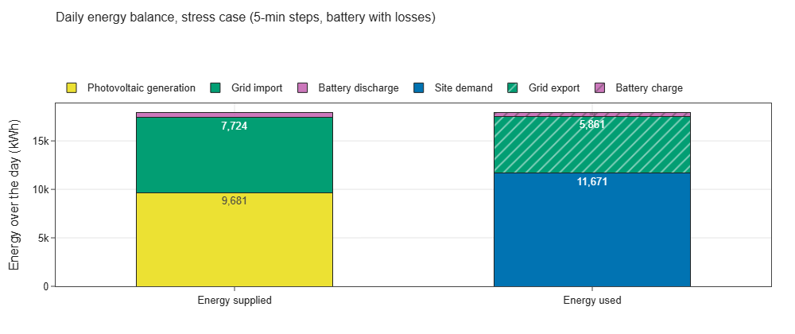
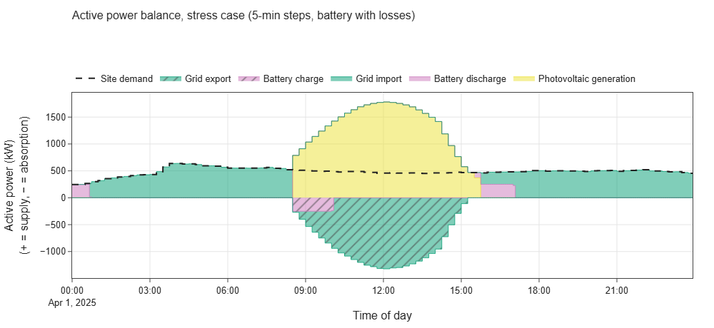
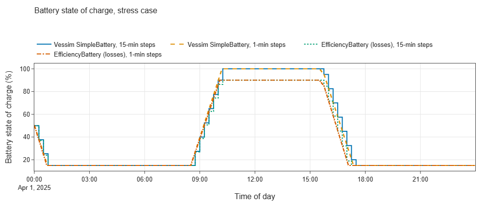
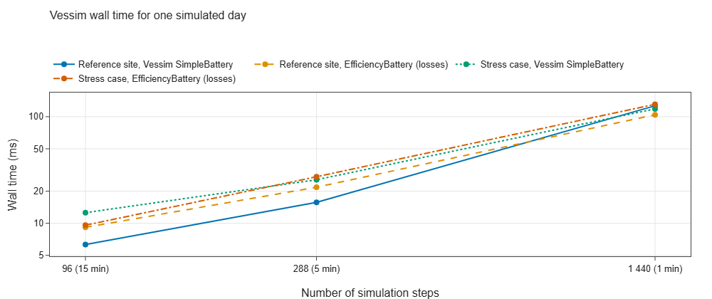

# E00 — Setup and smoke test

- Branch: `exp/e01-energy-equivalence` (delivered together with E01)
- Notebook: `notebooks/E00_setup_smoke.ipynb`
- Date: 2026-11-10
- Vessim: 0.16.0 (PyPI) with mosaik 3.7.1; Python 3.13.5 in `.venv`
- Wall time: notebook ≈ 15 s end to end (12 Vessim runs)

## Question

Does the toolchain work in `.venv`, and does Vessim conserve energy on the reference edge site —
at every step and over the day — across battery models and step sizes?

## Setup

- **Toolchain check.** Package versions, the `vessim_eval` helper package (editable install), the
  cached edge data in `data/`, and the separate edge study environment (`external/.venv-edge`).
- **Reference site.** Inputs of edge study S1.2 (IT hardware, cooling, building, PV; 15-min samples
  from `data/e01_edge_s1_2_15min.csv`), 500 kWh battery with the edge study's parameters,
  `GridConnection` without limits, Vessim's greedy `DefaultDispatchPolicy`.
- **Stress case (synthetic).** IT and cooling load at 10 %, PV x3. This forces battery charging,
  a full battery and grid export, which the reference site never reaches (PV < demand all day).
- **Variants.** Two battery models (Vessim's `SimpleBattery`; the custom loss-aware
  `EfficiencyBattery` from E01) × three step sizes (15, 5, 1 min) × two cases = 12 runs.
- **Checks.** Power balance residual per step; daily energy closure including battery losses;
  Vessim's built-in recorder metrics vs independent integration; wall time.

## Results

### Toolchain

| Component | Version / status |
|---|---|
| Python | 3.13.5 (`.venv`) |
| vessim | 0.16.0 |
| mosaik | 3.7.1 |
| numpy / pandas | 2.5.4 / 3.1.1 |
| plotly / seaborn | 7.1.0 / 0.13.2 |
| Reference data, edge environment | present |

### Energy conservation

- The maximum power balance residual is 9.1e-13 kW (reference) and 2.3e-13 kW (stress) in all 12 runs.
- The daily closure error (supply − use) is 0.00 kWh in all runs.

Daily energy balance (kWh), 15-min steps:

| Case | Battery model | PV | Grid import | Battery discharge | Demand | Grid export | Battery charge | Battery losses |
|---|---|---|---|---|---|---|---|---|
| Reference | SimpleBattery | 3 226.9 | 109 982.5 | 175.0 | 113 384.4 | 0.0 | 0.0 | 0.00 |
| Reference | EfficiencyBattery | 3 226.9 | 109 991.3 | 166.3 | 113 384.4 | 0.0 | 0.0 | 8.75 |
| Stress | SimpleBattery | 9 680.7 | 7 646.1 | 600.0 | 11 670.7 | 5 831.1 | 425.0 | 0.00 |
| Stress | EfficiencyBattery | 9 680.7 | 7 723.6 | 522.5 | 11 670.7 | 5 861.4 | 394.7 | 47.24 |

The battery losses are as expected. In the reference case, 175 kWh leave storage and 166.25 kWh
reach the bus, so 8.75 kWh (5 %) are lost. In the stress case, 47.24 kWh are lost over both
directions.

### Recorder metrics

Vessim's built-in metrics (`grid_import`, `grid_export`, `energy_produced`, `energy_consumed`,
`peak_grid_import`) match the integrated time series to ≤ 2e-8 Wh. The recorder also writes an
experiment record (`experiment.json`, `timeseries.csv`) that the Vessim viewer can open.

### Step size

The daily totals are identical at 15, 5 and 1 min for both cases and both battery models. Only the
resolution of the SOC trajectory changes. Inputs are piecewise constant over 15 min, and the
battery's feasible range is energy-limited, so a battery that reaches its limit mid-interval stores
the same energy at any step size.

### Wall time

Roughly 50–130 µs per step: 96 steps (15 min) ≈ 5–13 ms, 1 440 steps (1 min) ≈ 70–120 ms for
one simulated day. The cost scales linearly with the number of steps.

### Why the edge study co-simulation is much slower

A timed run of edge scenario S1.2 (one day, no profiler; timers wrapped around the scheduler and
the battery LP) gave:

| Part of the edge run | Wall time | Share |
|---|---|---|
| Greedy job scheduler (`scheduler.solve_job_scheduling_greedy`), 2 555 calls | 158.1 s | 96.1 % |
| Offline battery LP (`battery_optimizer`, 1 call) | < 0.1 s | ≈ 0 % |
| Everything else: mosaik coordination, hardware, cooling chain, weather, market, recorder, CSV output | ≈ 6.4 s | ≈ 3.9 % |
| **Total** | **164.5 s** | |

- The controller calls the scheduler at every 30-s scheduling step while jobs are pending. Each
  call loops in pure Python over pending jobs × candidate start slots × committed capacity.
  A cProfile run counted ≈ 61 M generator evaluations and ≈ 540 M dictionary lookups in it.
- Without the scheduler, the physical co-simulation (≈ 25 mosaik simulators, ≈ 2 650 event steps)
  takes ≈ 6 s per day, ≈ 2.4 ms per step. Vessim needs ≈ 0.05–0.13 ms per step, but its model is
  much smaller (4 actors, 2 dispatchables, no thermal or workload state).
- So the ≈ 1 000× gap in E01 (≈ 200 s vs ≈ 5–10 ms) is mostly workload scheduling, which Vessim
  does not model at all. On the energy layer alone the gap is ≈ 20–50× per step: mosaik's
  inter-simulator data exchange plus the edge study's richer physical models.
- Implication for the edge study: the greedy scheduler, not mosaik, limits run time. Vectorising
  it or calling it only when the queue changes would cut a day's run from ≈ 165 s to ≈ 10 s.
- The cProfile run attributed a further ≈ 725 s to a SciPy HiGHS option check called 3 times from
  mosaik's event loop. This does not show up in the unprofiled timing, so it is treated as a
  profiler attribution artefact.

## Interpretation

- The setup is ready for further experiments: `.venv`, helper package, cached data, plotting
  style, and a separate edge study environment for reference runs.
- Vessim's energy accounting is sound. The balance is enforced at every step by construction, and
  daily energy closes, including battery losses from a custom `Storage` subclass.
- `SimpleBattery` charges to 100 % SOC (no upper limit) and has no losses. This matters when
  comparing with the edge study's 15–90 % window and 95 % efficiencies (see E01).
- The default greedy dispatch empties the battery right away on the reference site. This is a
  property of the control, not an accounting issue (see E01, E02).

## Hypotheses

| Hypothesis | Verdict | Evidence |
|---|---|---|
| H4 — sound, clean energy-side abstractions | **Confirmed for energy accounting** | Exact per-step balance; daily closure 0 kWh; correct recorder metrics; custom storage plugs in without changes. |
| H7 — fast for short horizons | **Supported** | ≤ 0.13 ms per step; a 1-min, one-day run takes ≈ 0.1 s. Scaling with sites and the mosaik backend follows in E09. |

## Implications for the edge data center study

- **Adopt:** a closure test like this one (supply = use + losses over the run, and a residual
  check per step) as a regression test for the edge study's energy supply. E01 shows it would
  catch the sampling and unlogged-charging issues.
- **Adopt:** Vessim's recorder pattern — built-in KPIs with units and descriptions, saved with the
  time series in one experiment record.

## Limitations of this experiment

- The stress case is synthetic, only to exercise code paths; its numbers have no physical meaning
  for the edge site.
- Only the default (pure Python) backend; the mosaik backend is covered in E07/E09.
- Wall times are from one laptop run each; small runs are dominated by timing noise.
