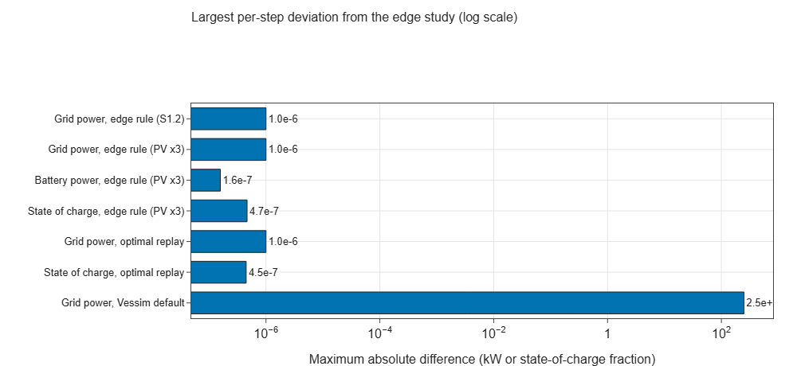
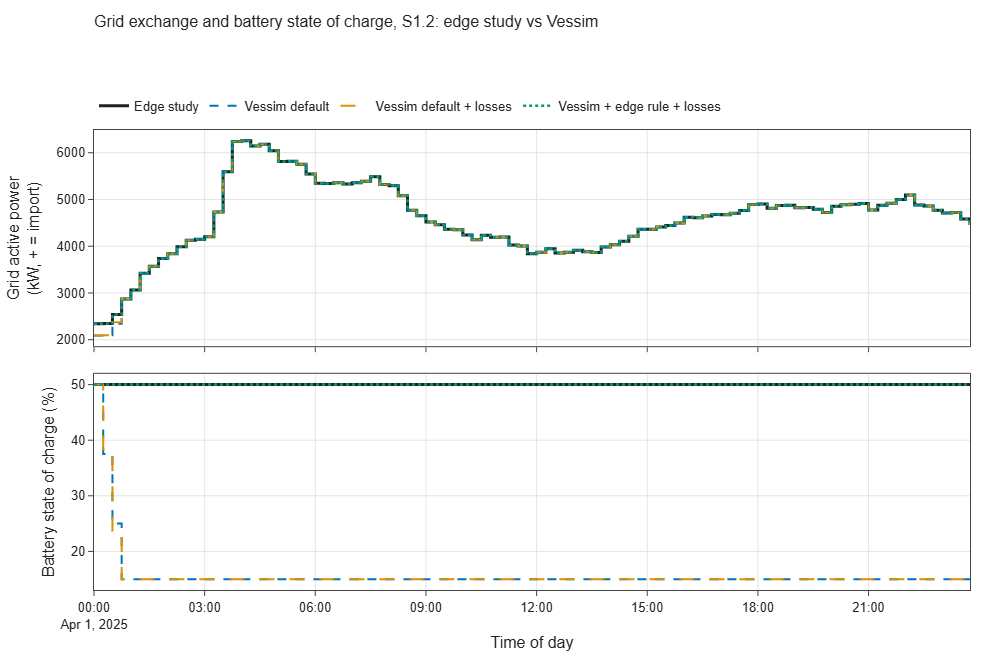
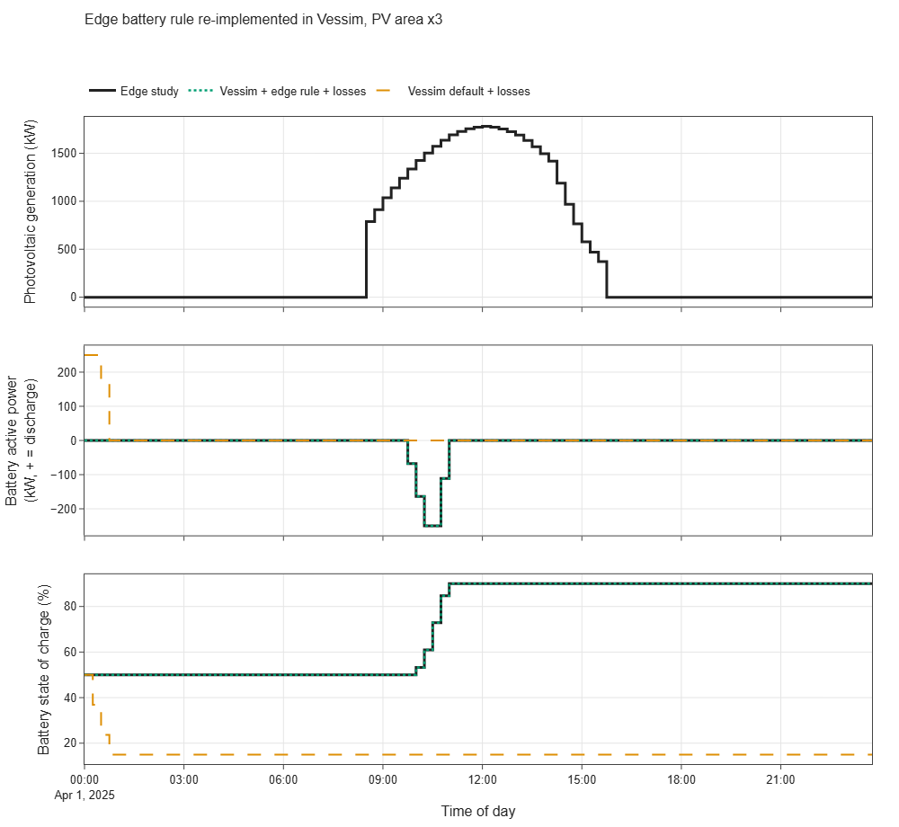
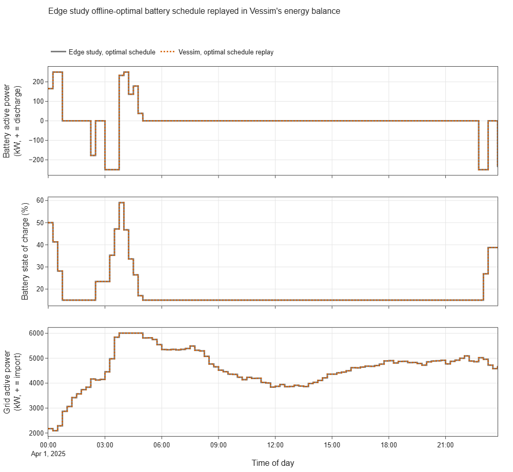

# E01 — Energy-side equivalence with the edge data center study

- Branch: `exp/e01-energy-equivalence`
- Notebook: `notebooks/E01_energy_equivalence.ipynb`
- Date: 2026-11-10
- Vessim: 0.16.0 (PyPI), source read at commit `3feef2d`
- Edge study: commit `3e8533a`, run in `external/.venv-edge` (Python 3.12)
- Wall time: notebook ≈ 14 s end to end; each Vessim run ≈ 5–10 ms; edge study reference run ≈ 165–200 s per simulated day (96 % in its greedy job scheduler — see the E00 report)

## Question

Given identical load, PV and battery inputs, do Vessim and the edge study produce the same grid
exchange and battery state of charge? If not, which modelling assumptions explain the gap?

## Setup

**Reference.** Edge study scenario `s1_2_battery_pv_large`: one data center, 2025-04-01, one day,
15-min physical step, 500 kWh battery (SOC 15–90 %, ±250 kW, 95 % charge and discharge efficiency),
5 000 m² PV, objective `peak_load`. A second run is identical except for 15 000 m² of PV ("PV x3"),
because in S1.2 the edge battery rule never operates (see results). Recorded IT hardware, cooling,
building and PV power were resampled to 15 min and cached in `data/` (see `data/README.md`).

**Vessim configurations** (all driven by the same `Trace` inputs):

| Configuration | Battery model | Battery control |
|---|---|---|
| Vessim default | built-in `SimpleBattery` | built-in `DefaultDispatchPolicy` (greedy) |
| Vessim default + losses | custom `EfficiencyBattery` (edge parameters) | `DefaultDispatchPolicy` |
| Vessim + edge rule + losses | `EfficiencyBattery` | edge online rule as custom `Controller` + `SetpointPolicy` |
| Vessim, optimal schedule replay | `EfficiencyBattery` | edge offline-optimal (LP) schedule passed as a grid signal |

Custom components are in `src/vessim_eval/vessim_models.py` (≈ 120 lines of code).
No randomness is involved; the edge job trace is the scenario's fixed file.

## Results

### Agreement with the edge study

| Comparison | Max. absolute difference | Daily energy difference |
|---|---|---|
| Grid power, edge rule, S1.2 | 1.0e-6 kW | -1.8e-6 kWh |
| Grid power, edge rule, PV x3 | 1.0e-6 kW | -1.7e-6 kWh |
| Battery power, edge rule, PV x3 | 1.6e-7 kW | -4.0e-8 kWh |
| State of charge, edge rule, PV x3 | 4.7e-7 | — |
| Grid power, optimal schedule replay | 1.0e-6 kW | -1.3e-6 kWh |
| State of charge, optimal schedule replay | 4.5e-7 | — |
| Grid power, **Vessim default** | **250 kW** | **-175 kWh** |

Residual differences are the 6-decimal rounding of the cached CSV. Vessim's power-balance residual
is ≤ 1e-12 kW at every step in every configuration.

### Energy indicators, S1.2

| | Grid import (kWh) | Peak grid import (kW) | Battery charge (kWh) | Battery discharge (kWh) | SOC range (%) |
|---|---|---|---|---|---|
| Edge study | 110 157.5 | 6 255.3 | 0.0 | 0.0 | 50–50 |
| Vessim default | 109 982.5 | 6 255.3 | 0.0 | 175.0 | 15–50 |
| Vessim default + losses | 109 991.3 | 6 255.3 | 0.0 | 166.2 | 15–50 |
| Vessim + edge rule + losses | 110 157.5 | 6 255.3 | 0.0 | 0.0 | 50–50 |
| Edge study, optimal schedule | 110 198.1 | 6 005.3 | 416.0 | 375.4 | 15–59 |
| Vessim, optimal schedule replay | 110 198.1 | 6 005.3 | 416.0 | 375.4 | 15–59 |

### PV x3: the edge rule in an active regime

| | Grid import (kWh) | Battery charge (kWh) | Battery discharge (kWh) | SOC range (%) |
|---|---|---|---|---|
| Edge study | 103 904.1 | 210.5 | 0.0 | 50–90 |
| Vessim + edge rule + losses | 103 904.1 | 210.5 | 0.0 | 50–90 |
| Vessim default + losses | 103 527.4 | 0.0 | 166.2 | 15–50 |
| Edge study, optimal schedule | 103 734.2 | 416.0 | 375.4 | 15–59 |

### Offline-optimal schedule replay

### Input sampling

Feeding Vessim time-weighted 15-min means instead of step-start samples raises daily grid import
from 110 158 kWh to 110 534 kWh (+376 kWh, +0.34 %).

### Run time of the edge study and improvement potential

A timed run of S1.2 (one day, no profiler; timers around the job scheduler and the battery LP):

| Part of the edge run | Wall time | Share |
|---|---|---|
| Greedy job scheduler (`solve_job_scheduling_greedy`), 2 555 calls | 158.1 s | 96.1 % |
| Offline battery LP (`battery_optimizer`, 1 call) | < 0.1 s | ≈ 0 % |
| Everything else: mosaik coordination, hardware, cooling chain, weather, market, recorder | ≈ 6.4 s | ≈ 3.9 % |
| **Total** | **164.5 s** | |

- The run time comes from the job scheduler, not from mosaik or the physical models. The
  controller calls it at every 30-s scheduling step while jobs are pending. Each call loops in pure
  Python over pending jobs × candidate start slots × committed capacity (a cProfile run counted
  ≈ 61 M generator evaluations and ≈ 540 M dictionary lookups).
- The physical co-simulation alone takes ≈ 6 s per day (≈ 2.4 ms per event step, ≈ 25 simulators).
  Vessim needs ≈ 0.05–0.13 ms per step for a much smaller model, so the like-for-like gap on the
  energy layer is ≈ 20–50×, not ≈ 1 000×.
- **Improvement potential: a day's run could drop from ≈ 165 s to ≈ 10 s (≈ 15×)** if the
  scheduler cost is removed. Options, roughly in order of effort:
  1. Call the scheduler only when the job queue or available capacity changes, instead of every
     30 s while jobs are pending.
  2. Keep committed capacity per slot in a NumPy array and test feasibility of all candidate start
     slots of a job in one vectorised operation, instead of nested generator expressions over dicts.
  3. Limit candidate start slots to a window (for example up to the job deadline at a coarser
     resolution).
  These change run time only; the schedules must be checked for equality against the current
  implementation (same job trace, same seed) before adoption.

## Interpretation

1. **The energy balance and battery models of both tools are equivalent** once conventions are
   aligned: the same inputs, battery model and control law give identical results to numerical
   precision, in both an idle and an active battery regime and for a replayed schedule.
2. **Vessim's built-in components do not match our study.** `SimpleBattery` has no charge or
   discharge efficiency, no upper SOC limit and one symmetric C-rate. `DefaultDispatchPolicy` is
   greedy: it empties the battery to minimum SOC in the first hour, which does nothing for the peak
   (6 255 kW in both cases). The offline-optimal schedule lowers the peak by 250 kW. The built-in
   `ClcBattery` (electrochemical model) was not used because it is parameterised per cell, not by
   capacity and efficiency.
3. **Vessim's extension points are sufficient but narrow.**
   - A `Storage` subclass needs only `feasible_range`, `step`, `soc`, `config`, `state`.
   - A `DispatchPolicy` receives only the net imbalance, the interval length and grid signals —
     no timestamp, no actor states, no forecast. A time-varying schedule had to be smuggled in as a
     grid signal.
   - A rule that needs individual actor powers (PV, building load) must be a `Controller`, which
     runs *after* dispatch, so its setpoints take effect one step later. Here this happens to match
     the edge study's time-shifted mosaik connection; for other controllers it is a constraint.
4. **The comparison surfaced four issues in the edge study:**
   - In S1.2 the online battery rule is inactive all day: it only charges from PV above the base
     load (PV peak 594 kW < base load ≈ 1 170 kW) and never discharges. The battery's value in S1.2
     comes only from the offline LP benchmark.
   - The recorder logs only battery discharge (`e_el_out`); charging appears only inside total
     demand.
   - Measured SOC is recorded at the end of a step, while the LP schedule's SOC is at the start.
   - Grid and energy-supply accounting hold the demand value sampled at each 15-min step while IT
     power changes every 30 s. This under-counts daily grid import by ≈ 0.34 % (up to 344 kW in a
     single step) compared with time-weighted inputs.

## Hypotheses

| Hypothesis | Verdict | Evidence |
|---|---|---|
| H4 — Vessim's energy-side abstractions are cleaner | **Partially confirmed** | The strict balance check and clean `Dispatchable`/`DispatchPolicy`/`Controller` split are confirmed (exact agreement, balance residual ~1e-12). But the built-in battery and dispatch are simpler than ours; parity needed custom components. |
| H3 — Flexibility management is weak | **Supported (preliminary)** | The built-in policy is single-step greedy; policies see no time, actor states or forecasts. Tested further in E02/E05. |
| H7 — Vessim is fast | **Supported (preliminary)** | ≈ 5–10 ms per simulated day for one site at 15 min. Not like-for-like with the edge run (≈ 165–200 s): 96 % of that is the greedy job scheduler, and the physical co-simulation alone takes ≈ 6 s (see E00 report). Quantified further in E09. |

## Implications for the edge data center study

- **Adopt:** a strict per-step power-balance assertion in the energy supply / grid connection, as in
  Vessim. It would have caught the sampling mismatch and the unlogged charging power.
- **Adopt:** record net battery power (charge and discharge) and use one SOC timing convention
  for measurements and the LP benchmark.
- **Fix or document:** time-weighted energy accounting (or a step size matching the hardware
  update) for grid import and cost; currently ≈ 0.34 % of daily energy is lost.
- **Review:** the S1.2 battery rule. Charging only from surplus above base load, with no
  discharge, makes the battery inert in S1.2; any S1.x claim about battery benefit relies on the
  LP benchmark.
- **Speed up:** the greedy job scheduler takes 96 % of the run time. Event-triggered calls and a
  vectorised feasibility check could cut a one-day run from ≈ 165 s to ≈ 10 s, which makes
  parameter sweeps and multi-day runs practical. Verify identical schedules before adopting.
- **Positioning:** our battery model (efficiency, SOC window, asymmetric limits) and our
  optimisation-based scheduling are richer than Vessim's built-ins. Vessim's advantage is its clean
  separation of models, dispatch and control, and its speed.
- **Reuse option:** Vessim can serve as a fast energy-balance back end for our controller logic
  (rule or LP schedule) during development, since results are identical.

## Limitations of this experiment

- One spring day and one site; no grid export occurs (PV < demand at all times), so export paths
  are untested.
- Inputs were taken from the edge run's outputs, so the comparison tests the energy layer only,
  not the workload or thermal models that generate demand (E03, E04).
- The PV x3 case modifies only PV area; the job trace and weather are unchanged.
- `ClcBattery` and step-size sensitivity were not tested (planned in E02).
