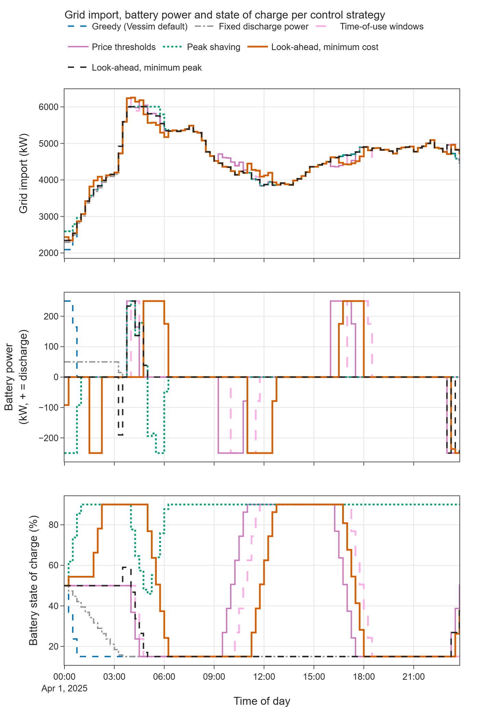
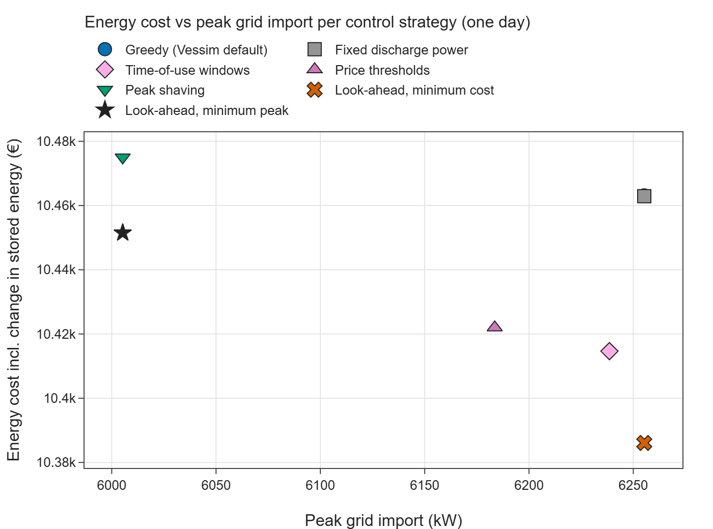
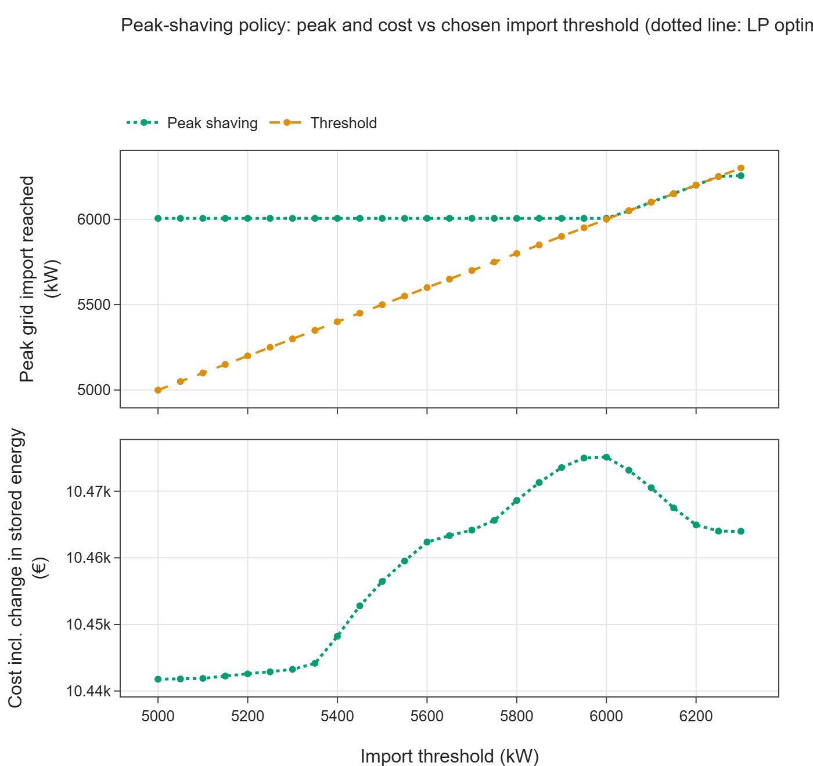
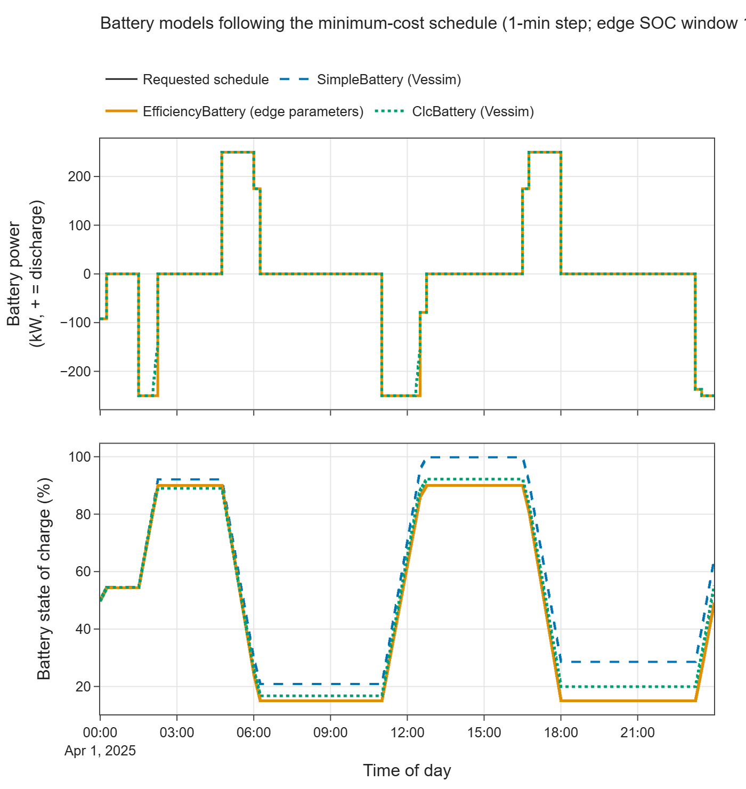
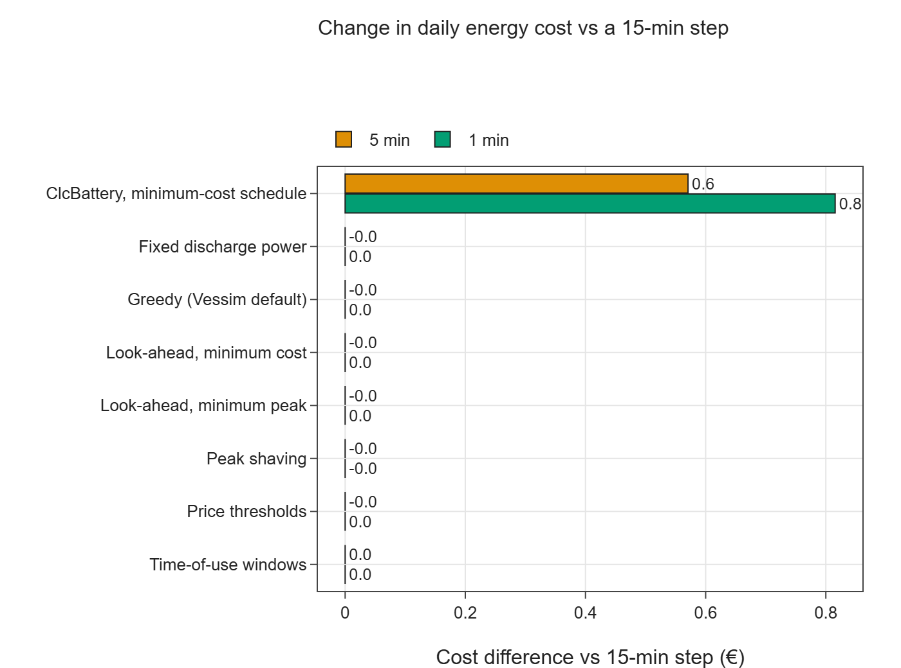

# E02 — Dispatch policies and storage models

- Branch: `exp/e02-dispatch-and-storage` (branched from `exp/e01-energy-equivalence`, which holds the shared
  helpers and is not yet merged into `main`)
- Notebook: `notebooks/E02_dispatch_and_storage.ipynb`
- Date: 2026-11-10
- Vessim: 0.16.0 (PyPI), source read at commit `3feef2d`; SciPy 1.18.1 (HiGHS) for the look-ahead LP
- Wall time: notebook ≈ 22 s end to end; 66 Vessim runs, median ≈ 15 ms per simulated day (max ≈ 0.18 s at 1-min step)

## Question

What battery control logic can Vessim express natively, what has to be written by hand, and how do Vessim's
battery models differ from each other and from the edge study's battery?

## Setup

- **Site:** inputs of edge scenario S1.2, 2025-04-01, one day (IT hardware, cooling, building, PV; 15-min samples
  from `data/e01_edge_s1_2_15min.csv`). PV is always below demand, so there is no export.
- **Battery:** edge parameters (500 kWh, ±250 kW, SOC 15–90 %, 95 % charge and discharge efficiency, start at
  50 %). The loss-aware `EfficiencyBattery` from E01 is used unless stated otherwise.
- **Price:** the DE-LU day-ahead price used by the edge run (11–180 €/MWh). It is recovered exactly from the
  LP columns of the cached reference (`price = LP cost / (LP grid power × Δt)`), so no new data was needed.
- **Control strategies:**

| Strategy | How it is built in Vessim | Foresight it needs | Custom lines of code |
|---|---|---|---|
| Greedy (Vessim default) | built-in `DefaultDispatchPolicy` | none | 0 |
| Fixed discharge power | built-in `DefaultDispatchPolicy(charge_power=−50 kW)` | none | 0 |
| Time-of-use windows | built-in policy + custom `Controller` switching `charge_power` (discharge 04–07 h and 17–21 h, charge 10–13 h) | fixed tariff windows | 11 |
| Price thresholds | custom `DispatchPolicy`: charge below the day's 25th price percentile, discharge above the 75th | the day's price distribution | 28 |
| Peak shaving | custom `DispatchPolicy` using only the current imbalance: discharge above an import threshold, recharge below it | the threshold | 26 |
| Look-ahead, minimum cost / minimum peak | LP with perfect foresight of load and price, solved before the run and replayed through a grid signal | perfect forecast | 61 (LP + replay policy) |

  The LP uses the same formulation as the edge study's `simulators/battery_optimizer.py` (SOC dynamics with
  efficiencies, final SOC = initial SOC) plus a tiny throughput penalty that breaks ties between equally optimal
  schedules. Helpers are in `src/vessim_eval/dispatch.py`. Line counts exclude comments and docstrings.
- **Battery models:** Vessim `SimpleBattery`, Vessim `ClcBattery` (C-L-C electrochemical model; 26 123 default
  cells of 19.14 Wh, C-rates set to ±0.5 C = ±250 kW) and the custom `EfficiencyBattery`, each following the same
  requested minimum-cost schedule, plus each under greedy dispatch.
- **Step size:** 15, 5 and 1 min for every strategy and battery model.
- **Fair cost comparison:** strategies end the day with different stored energy. The cost is therefore also
  reported *including the change in stored energy*, valued at the day's mean price (91.2 €/MWh).
- No randomness is involved.

## Results

### Control strategies (15-min step)

| Strategy | Cost incl. stored-energy change (€) | vs greedy (€) | Peak grid import (kW) | vs greedy (kW) | Battery discharge (kWh) | Battery losses (kWh) | Full cycles | Final SOC (%) |
|---|---|---|---|---|---|---|---|---|
| Greedy (Vessim default) | 10 463.1 | 0.0 | 6 255.3 | 0 | 166.3 | 8.8 | 0.33 | 15.0 |
| Fixed discharge power | 10 462.9 | −0.2 | 6 255.3 | 0 | 166.3 | 8.8 | 0.33 | 15.0 |
| Time-of-use windows | 10 414.7 | −48.5 | 6 238.6 | −17 | 522.5 | 47.2 | 1.05 | 15.0 |
| Price thresholds | 10 422.0 | −41.1 | 6 183.6 | −72 | 522.5 | 59.7 | 1.04 | 62.5 |
| Peak shaving | 10 475.0 | +11.9 | 6 005.3 | −250 | 209.2 | 33.1 | 0.42 | 90.0 |
| Look-ahead, minimum cost | 10 386.1 | −77.1 | 6 255.3 | 0 | 712.5 | 77.0 | 1.42 | 50.0 |
| Look-ahead, minimum peak | 10 451.5 | −11.6 | 6 005.3 | −250 | 209.2 | 22.6 | 0.42 | 50.0 |

All strategies keep the SOC within 15–90 %. Our minimum-peak LP gives the same optimal peak as the edge study's
own offline LP (6 005.3 kW).

### Peak shaving without a forecast

Sweeping the peak-shaving threshold from 5 000 to 6 300 kW:

- Any threshold at or below ≈ 6 005 kW gives the same optimal peak of 6 005.3 kW.
- Higher thresholds give peak = threshold.

On this day the battery is limited by its power (250 kW), not by its energy. The load stays below any such
threshold long enough for the battery to recharge before the morning peak. Lower thresholds cycle the battery more.
Because the morning load peak coincides with high prices, this lowers the cost by up to ≈ 33 €.

### Battery models following the same schedule (1-min step)

| Model | Discharge delivered / requested (kWh) | Charge accepted / requested (kWh) | Losses (kWh) | SOC range (%) | Final SOC (%) | Within 15–90 %? |
|---|---|---|---|---|---|---|
| `SimpleBattery` (Vessim) | 712.5 / 712.5 | 789.5 / 789.5 | 0.0 | 20.9–99.8 | 65.4 | no |
| `ClcBattery` (Vessim) | 712.5 / 712.5 | 769.2 / 789.5 | 26.9 | 16.7–92.2 | 56.0 | no |
| `EfficiencyBattery` (edge parameters) | 712.5 / 712.5 | 789.5 / 789.5 | 77.0 | 15.0–90.0 | 50.0 | yes |

Under greedy dispatch, the three models discharge 175.0, 172.6 and 166.3 kWh respectively before reaching the
15 % minimum SOC.

### Step size

All strategies give identical daily cost, peak and battery throughput at 15, 5 and 1 min. Only `ClcBattery`
changes: +0.6 € at 5 min and +0.8 € at 1 min, with accepted charge rising from 756 kWh to 769 kWh.

## Interpretation

1. **Vessim's native control is greedy or constant.**
   - `DefaultDispatchPolicy` empties the battery in the first hour (E01).
   - Its only parameter, a fixed `charge_power` per storage, applies to the whole run. It discharges more
     slowly but reaches the same result.
   - `charge_power = 0` means "greedy", not "idle". Idle periods therefore need a workaround: the
     time-of-use controller uses a negligible 1 µW setpoint.
2. **Rule-based strategies are cheap to write.** The `DispatchPolicy` interface is small and clean, and a
   threshold rule takes about 25–30 lines. A policy can read grid signals (price) and the storages' SOC and
   feasible ranges. It cannot see:
   - the time;
   - forecasts;
   - the individual actor powers (only their net sum).

   Time-dependent rules have to go through a `Controller`, which acts after dispatch and so decides for the
   next interval.
3. **Look-ahead is entirely the user's job.** There is no forecast interface, no horizon and no optimiser in
   Vessim. The LP was solved outside the simulation and passed in as a grid signal named `setpoint_battery_w`, as
   in E01. A rolling-horizon controller would need a `Controller` that re-solves and writes setpoints into a
   custom policy, with the one-step delay.
4. **The objectives conflict.** On this day the battery's value is small: at most 0.7 % of the energy bill and
   4 % of the peak.
   - Minimising cost (charge in the midday price dip, discharge into the morning and evening peaks) does not
     lower the peak.
   - Minimising the peak costs more than the cost optimum.
   - Simple rules land in between. None of this is specific to Vessim, but Vessim offers no help in balancing
     the objectives (no multi-objective policy, no flexibility band).
5. **A forecast-free peak-shaving rule can be optimal.** It is optimal when the battery is limited by its
   power rather than its energy, as here. The open question about foresight concerns energy-limited days.
   Testing that needs a longer horizon or a smaller battery (E05).
6. **Vessim's battery models:**
   - `SimpleBattery` is an ideal store: no losses, no upper SOC limit, one symmetric C-rate.
   - `ClcBattery` is a real addition compared with our study:
     - current- and SOC-dependent charge acceptance (it could not absorb the last 2.6 % of the requested
       charge near full);
     - internal efficiencies.

     Its limitations:
     - parameterised per cell, not by capacity, efficiency and power;
     - no upper SOC limit, so it exceeded our 90 % limit;
     - depends on the step size, as the Vessim docstring warns.
   - Neither built-in model reproduces the edge battery. The custom `EfficiencyBattery` (≈ 50 lines, E01) is
     still needed.
7. **Minor code observation.** In `ClcBattery._discharge`, the power clip compares against
   `charging_power_cutoff` instead of `discharging_power_cutoff`. This has no effect in our runs, because
   `feasible_range` already applies the discharge cutoff.

## Hypotheses

| Hypothesis | Verdict | Evidence |
|---|---|---|
| H3 — Flexibility management is weak | **Supported for built-ins; partially rejected for extensibility** | The built-ins are greedy or constant, with no notion of idle, time, forecast, look-ahead or flexibility band. But rule-based policies take ≈ 25–30 lines, and an externally optimised schedule can be replayed exactly. Look-ahead and multi-objective control must be built outside Vessim. |
| H4 — Energy-side abstractions are cleaner | **Partially confirmed** | The `DispatchPolicy` / `Controller` / `Storage` split makes strategies easy to swap, and runs are step-size robust. `ClcBattery` adds electrochemical behaviour our study lacks. But both built-in batteries lack an upper SOC limit and asymmetric power and efficiency parameters, so they violate our 15–90 % window when following a schedule. |
| H7 — Fast | **Supported** | ≈ 15 ms per simulated day at 15 min; 66 runs in 1.4 s. |

## Implications for the edge data center study

- **Adopt (idea):** a policy interface like `DispatchPolicy`, where a strategy is one swappable object. The
  edge study's battery logic is embedded in `simulators/controller.py`. A pluggable policy would allow the
  strategies compared here — greedy, thresholds, time-of-use, peak shaving, LP replay — to run as scenario
  variants without editing the controller.
- **Adopt (benchmark set):** the strategy table above as a baseline set for the battery. In S1.2 the edge
  study's online rule is idle all day (E01). Even simple rules would show the battery's online value:
  −41 to −49 € per day, or −250 kW peak.
- **Consider:** a current-dependent charge limit like `ClcBattery`'s near full charge. It cut charge acceptance
  by 2.6 % here, a small effect at a 15-min step. The 95 %/95 % efficiency model gives ≈ 3× the losses of the
  C-L-C cell defaults. That gap is a parameter question worth checking against the datasheet of the assumed
  battery.
- **Positioning:** the edge study's offline LP benchmark and flexibility band go beyond anything Vessim
  provides. Its online battery rule, however, is weaker than a 26-line peak-shaving policy in Vessim.
- **Ignore:** `SimpleBattery` for anything quantitative; it has no losses or upper SOC limit.

## Limitations of this experiment

- One day and one site; the battery is small relative to the load (500 kWh vs ≈ 110 MWh per day), so all
  savings are small in relative terms.
- Price and time-of-use thresholds were tuned with knowledge of the day; they are as optimistic as the
  look-ahead, just simpler.
- The look-ahead uses perfect forecasts; no forecast error and no rolling horizon.
- No grid export, no import limits or ramp constraints (`GridConnection` supports them; covered in E05).
- `ClcBattery` uses the default LG M50 cell parameters, not a datasheet of the edge study's battery.
