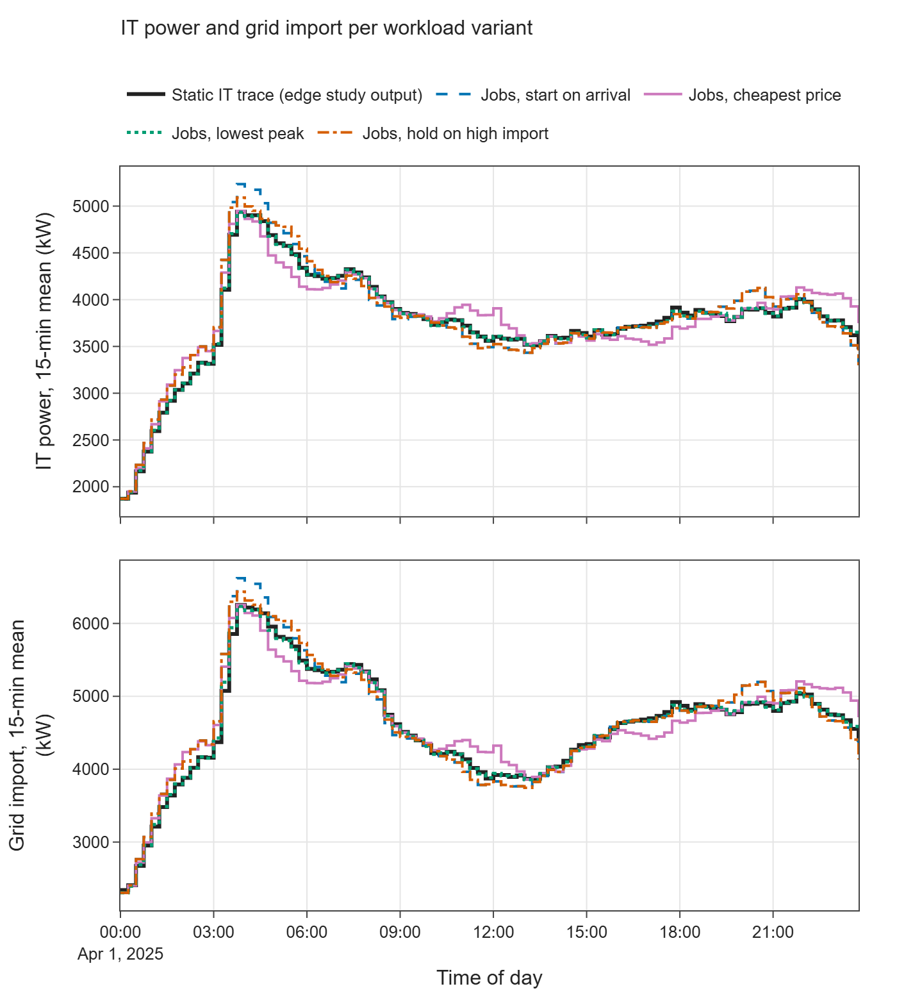
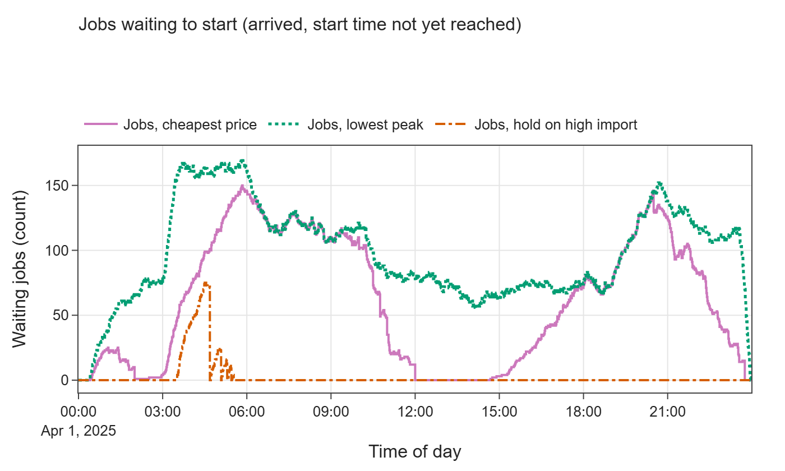
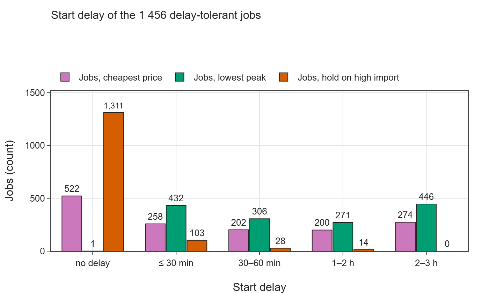
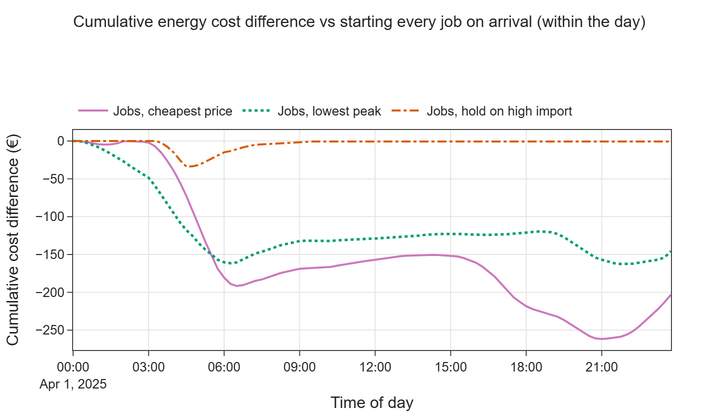
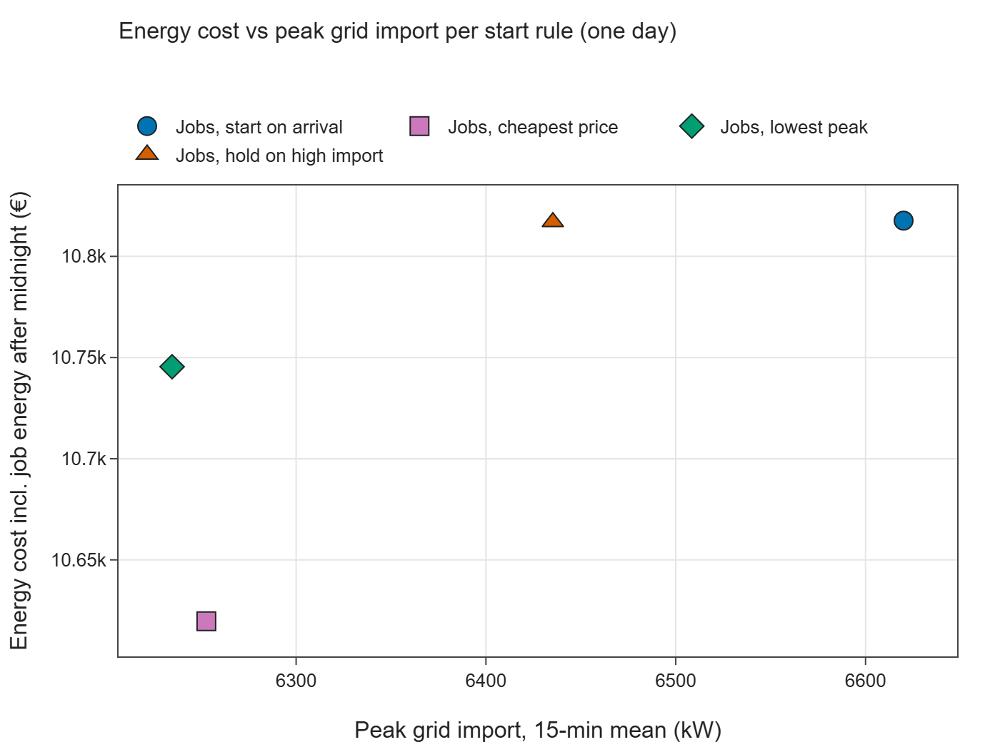

# E03 — Dynamic workload

- Branch: `exp/e03-dynamic-workload` (branched from `exp/e02-dispatch-and-storage`; the shared helpers are not yet on `main`)
- Notebook: `notebooks/E03_dynamic_workload.ipynb`
- Date: 2026-11-11
- Vessim: 0.16.0 (PyPI), source read at commit `3feef2d`
- Wall time: notebook ≈ 33 s end to end; one simulated day with 7 279 jobs at a 1-min step takes 0.7 s (start on
  arrival) to ≈ 5 s (forecast-based start rules)

## Question

Vessim treats demand as a power signal. How much effort does it take to add jobs, queues and temporal shifting? What
does that give, and how does it compare with the edge study's scheduler?

## Setup

- **Site:** edge study S1.2, 2025-04-01, one day. Building and PV come from the edge run, together with the day-ahead
  price (recovered as in E02). The site is grid-only, with no battery, to isolate the workload effect.
- **Jobs:** the scenario's own trace, `config/aggregated_jobs_60_OL_20.json`, stored compactly as
  `data/e03_edge_jobs_60_OL_20.csv` (243 kB):
  - 7 279 jobs with CPU demand and runtime;
  - 20 % are delay-tolerant, with a maximum start delay of 30 min (415 jobs), 1 h (292), 2 h (265) or 3 h (484);
  - no randomness is involved.
- **Server pool:** the edge study's linear model (`simulators/hardware.py`):
  - 614 000 CPUs, 7.3 W per CPU at peak, 21.7 % idle power;
  - 900 kW base load;
  - IT power therefore ranges from 1 873 to 5 382 kW.
- **Cooling:** Vessim has no thermal model, so cooling is a linear fit to the edge run (0.284 · IT − 113.8 kW).
  E04 covers thermal modelling.
- **Custom components** (`src/vessim_eval/workload.py`):
  - `ClusterActor` — a `vs.Consumer` subclass that overrides `sample()`. At each step it:
    1. admits arriving jobs;
    2. sets their start time with a start rule;
    3. returns the exact mean IT power over the coming step, using CPU allocation tracked on the step grid with
       fractional overlaps.

    Delay-intolerant jobs always start on arrival. Shifted jobs must fit within the CPU capacity.
  - `CoolingProxy` — an actor that reads the cluster actor's power of the same tick.
  - `ImportHoldController` — a `vs.Controller` that holds delay-tolerant jobs while the observed grid import is
    above a threshold (6 000 kW). Held jobs are forced to start at their deadline.
- **Variants:**

| Variant | Delay-tolerant jobs start … | Where the logic lives |
|---|---|---|
| Static IT trace (edge study output) | — (the edge run's IT and cooling power as `Consumer` traces) | built-in |
| Jobs, start on arrival | on arrival | actor |
| Jobs, cheapest price | at the allowed slot with the lowest mean day-ahead price over the job's runtime | actor (price forecast) |
| Jobs, lowest peak | at the allowed slot with the lowest predicted site-import peak over the runtime (≈ the edge study's greedy `peak_load` scheduler) | actor (load forecast) |
| Jobs, hold on high import | when observed grid import ≤ threshold, at the latest at the deadline | controller (observation) |

- **Step:** 1 min for the job model (the edge scheduler uses 30 s); the reactive hold is also run at 5 and 15 min.

## Results

### Key numbers

| | Static trace (edge output) | Start on arrival | Cheapest price | Lowest peak | Hold on high import |
|---|---|---|---|---|---|
| IT energy in the day (kWh) | 90 465 | 91 047 | 91 003 | 90 420 | 91 047 |
| Job energy after midnight (kWh) | — | 1 575 | 1 619 | 2 202 | 1 575 |
| Grid import energy (kWh) | 110 534 | 111 280 | 111 223 | 110 476 | 111 280 |
| Energy cost, within the day (€) | 10 498.6 | 10 633.1 | 10 430.0 | 10 487.6 | 10 632.5 |
| **Cost incl. job energy after midnight (€)** | — | **10 817.7** | **10 619.7** | **10 745.5** | **10 817.0** |
| **Peak grid import, 15-min mean (kW)** | **6 252.9** | **6 620.1** | **6 252.7** | **6 234.7** | **6 435.3** |
| Peak grid import, 1-min (kW) | — | 6 691.1 | 6 336.9 | 6 265.2 | 6 536.8 |
| Delay-tolerant jobs shifted (of 1 456) | — | 0 | 934 | 1 455 | 145 |
| Mean / max start delay (min) | — | 0 / 0 | 60 / 180 | 96 / 180 | 2.6 / 70 |
| Max waiting jobs | — | 0 | 150 | 171 | 75 |
| Energy shifted (kWh) | — | 0 | 1 726 | 1 121 | 197 |
| Max CPU utilisation (%) | — | 97.4 | 89.5 | 87.9 | 93.9 |

No variant missed a deadline, started a job after midnight or placed a job above CPU capacity.

The fair cost is the one *including job energy after midnight*. Shifting moves job energy past the end of the day,
so it drops out of the within-day cost. That energy, together with its cooling, is valued here at the day's mean
price. Peaks are compared on 15-min means because the static trace has a 15-min resolution.

Compared with starting every job on arrival:

| Rule | Cost | 15-min peak |
|---|---|---|
| Cheapest price | −198 € (−1.8 %) | −367 kW |
| Lowest peak | −72 € | −385 kW |
| Reactive hold | −0.7 € | −185 kW |

### Job model vs the edge study

| Job-model variant vs edge IT power (15-min means) | Mean abs. difference (kW) | Max abs. difference (kW) | Daily IT energy difference (kWh) | Peak IT power (kW, edge: 4 940.6) |
|---|---|---|---|---|
| Start on arrival | 95.3 | 349.0 | +581.0 (+0.6 %) | 5 234.6 |
| Lowest peak | 10.9 | 213.1 | −45.3 (−0.05 %) | 4 934.3 |

The peak-aware greedy rule reproduces the edge run's IT power, energy and peak closely. This confirms that the job
trace, the power model and the scheduler logic are interpreted the same way. In the figure above, the edge trace hides
the lowest-peak line, and the reactive hold matches start-on-arrival outside the morning peak.

### Queue and start delays

The lowest-peak rule delays 1 455 of 1 456 delay-tolerant jobs, 446 of them by 2–3 h. A greedy rule only knows the
load already committed, and future arrivals are not yet committed. Later slots therefore always look emptier, and
jobs are pushed towards their deadline. The edge study's greedy scheduler has the same information and produces
the same IT profile.

### Cost and peak

### Reactive hold through a Controller: threshold and one-step delay

| Import threshold (kW) | Cost incl. after midnight (€) | 15-min peak (kW) | Jobs shifted | Mean / max delay (min) |
|---|---|---|---|---|
| 5 600 | 10 800.6 | 6 324.1 | 218 | 6.8 / 119 |
| 5 800 | 10 812.3 | 6 386.3 | 182 | 4.0 / 85 |
| 6 000 | 10 817.0 | 6 435.3 | 145 | 2.6 / 70 |
| 6 200 | 10 819.1 | 6 480.3 | 88 | 1.4 / 55 |

| Step size (threshold 6 000 kW) | 15-min peak (kW) | Jobs shifted |
|---|---|---|
| 1 min | 6 435.3 | 145 |
| 5 min | 6 480.3 | 131 |
| 15 min | 6 559.7 | 108 |

The controller sees the import only after dispatch, so its hold decision applies one step later. At a 15-min step,
this lag costs 125 kW of peak reduction compared with a 1-min step.

### Custom code

| Component | Lines (no comments or docstrings) |
|---|---|
| Server pool power model | 16 |
| Cluster actor (admission, four start rules, power) | 100 |
| Cooling proxy actor | 7 |
| Reactive hold controller | 6 |
| **Total model code** | **≈ 130** |

There are a further ≈ 120 lines of run and KPI helpers.

## Interpretation

1. **Vessim has no workload model.** Everything workload-related had to be written by hand: jobs, queues, deadlines,
   CPU capacity, start rules and job KPIs. The retrofit is small, though: ≈ 130 lines.
2. **The extension points are adequate.**
   - Overriding `Actor.sample()` is a documented way to plug in a custom model.
   - The `Recorder` logs extra actor state (waiting jobs, utilisation) automatically.
   - The job model reproduces the edge study's IT power to within 11 kW on average, 0.05 % of daily energy and 6 kW
     of peak.
3. **Workarounds were needed:**
   - *Sample-and-hold.* Vessim holds each actor sample for the whole step, so the actor must return the exact
     interval-mean power itself. Otherwise energy is lost; the edge study shows the same effect in E01, where it
     under-counts daily grid import by 0.34 %.
   - *Controller timing.* Controllers act after dispatch, so a decision based on observed grid import applies one
     step late. Rules that need only forecasts (price, planned load) can avoid this by living inside the actor. A
     truly reactive rule cannot.
   - *Actor coupling.* There is no data flow between actors. The cooling proxy reads an attribute of the IT actor,
     which only works because Vessim samples actors in list order.
   - *Horizon effects.* Shifting moves energy past the end of the simulated day, so costs need correcting for it.
     Otherwise shifting looks up to ≈ 75 € cheaper than it is (lowest-peak rule).
4. **In this scenario, workload flexibility is worth more than the battery.**
   - The 20 % delay-tolerant jobs (≈ 1.1–1.7 MWh shifted) lower the 15-min peak by up to 385 kW.
   - They also save up to 198 € per day.
   - The 500 kWh battery achieved at most 250 kW or 77 € (E02).
5. **Forecast-based shifting beats reactive holding.** Holding jobs only while import is high shaves 185 kW and
   saves almost nothing, because held jobs are released as soon as import drops or their deadline arrives. Planning
   at arrival with price or load forecasts does much better.
6. **Speed.** The lowest-peak rule reaches the edge study's result in ≈ 4 s, against ≈ 158 s for the edge
   scheduler (E00). Here each job is placed once, on arrival. The edge study re-plans the whole pending queue every
   30 s, with nested Python loops. The result is close (IT power within 11 kW on average), so most of that re-planning
   effort does not change the outcome for this trace.

## Hypotheses

| Hypothesis | Verdict | Evidence |
|---|---|---|
| H1 — Vessim has no workload model | **Confirmed** | No jobs, queues, deadlines or resource capacity, and no built-in way to shift demand. All of it had to be written by hand (≈ 130 lines). The retrofit is clean through a custom `Actor`, with two caveats: a reactive `Controller` lags one step, and actors cannot exchange data. |
| H3 — Flexibility management is weak | **Supported (workload side)** | There is no notion of flexible demand. Load shifting has to be modelled as a custom actor, with forecasts the user supplies. |
| H7 — Fast | **Supported** | 0.7–5 s per day with 7 279 jobs; the slot search is pure Python. |

## Implications for the edge data center study

- **Positioning:** workload management is a clear strength of the edge study. It has jobs with CPU and RAM, pools,
  delay tolerance, migration fields and a MILP or greedy scheduler. Vessim offers none of this. Using Vessim would
  mean porting the job model as a custom actor; this experiment shows the port is feasible and small.
- **Adopt (speed-up):** place each job once on arrival, keeping committed load per slot as an array. Do this
  instead of re-planning the whole pending queue every 30 s. For this trace it gives practically the same IT profile
  in ≈ 4 s instead of ≈ 158 s, which fits the improvement potential noted in E01 and E00. The MILP mode may still
  justify re-planning; that was not tested.
- **Review:** the greedy `peak_load` scheduler pushes almost all delay-tolerant jobs to the end of their window,
  because future arrivals are unknown. A small forecast of upcoming load, or a cap on voluntary delay, may serve users
  better at the same peak.
- **Report:** the value of workload flexibility (≈ 370–385 kW peak reduction, up to ≈ 200 € per day) exceeds that of
  the 500 kWh battery. Results should also account for energy shifted past the simulation horizon.
- **Adopt (accounting):** compute grid energy from interval-mean IT power, as the cluster actor does, rather than
  from step-start samples (E01: −0.34 %).

## Limitations of this experiment

- One day and one job trace; jobs arriving late in the day have little room to shift within the horizon.
- Cooling is a linear proxy fitted to the edge run. It ignores weather and the cooling chain's dynamics (E04).
- No RAM constraint; CPU capacity is enforced only when choosing a shifted start. On-arrival starts never exceeded
  capacity in this trace (max 97.4 %).
- The forecast-based rules use perfect forecasts of price, building and PV load.
- The edge MILP scheduler and spatial flexibility (migration between sites, E08) were not compared.
- No carbon-intensity signal is available for this scenario, so CO₂ was not evaluated.
