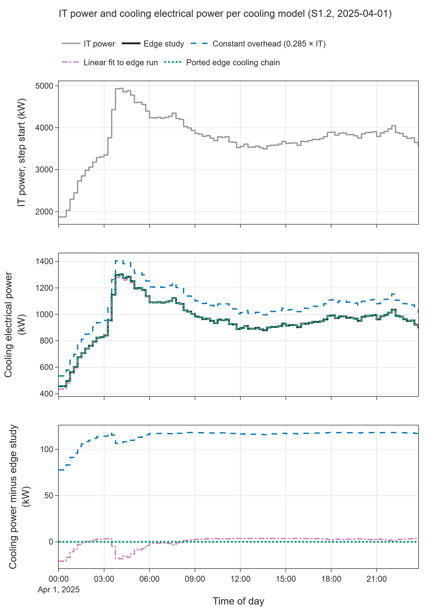
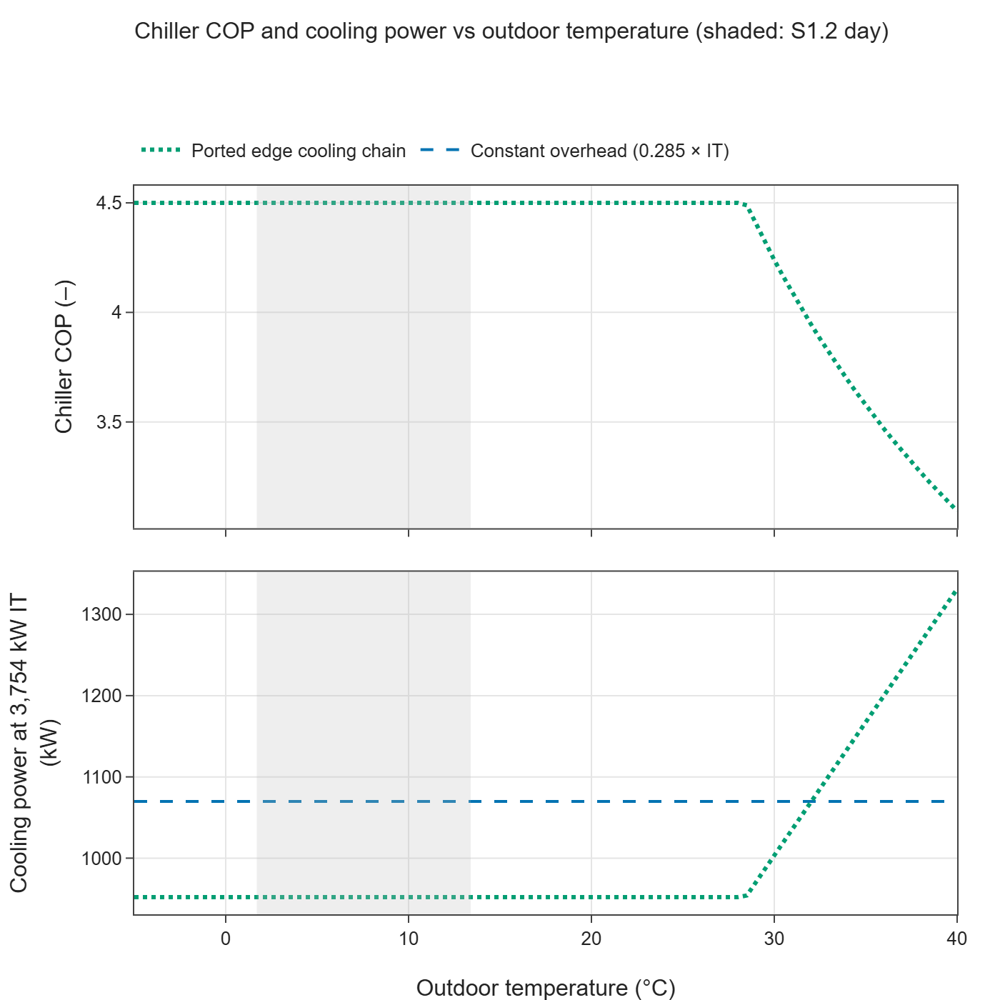
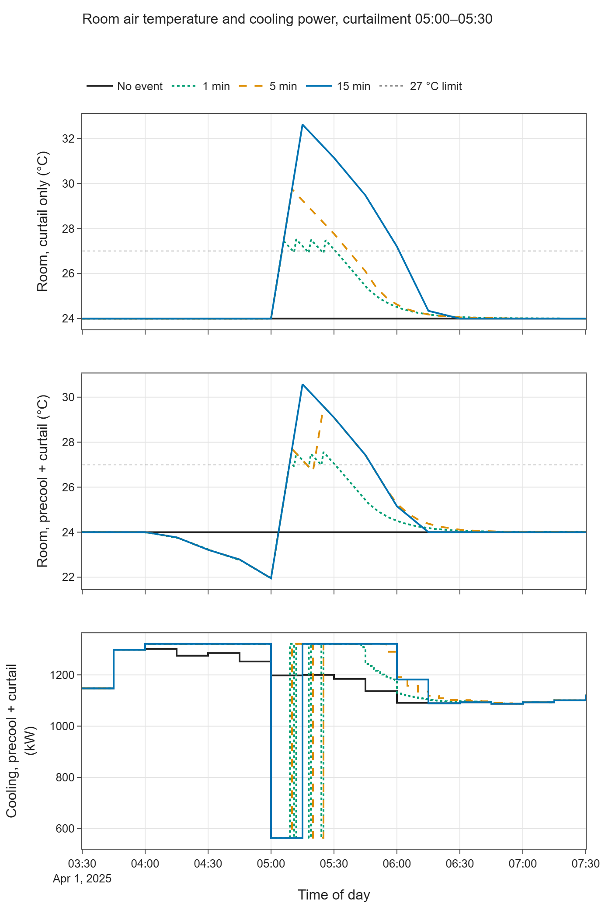
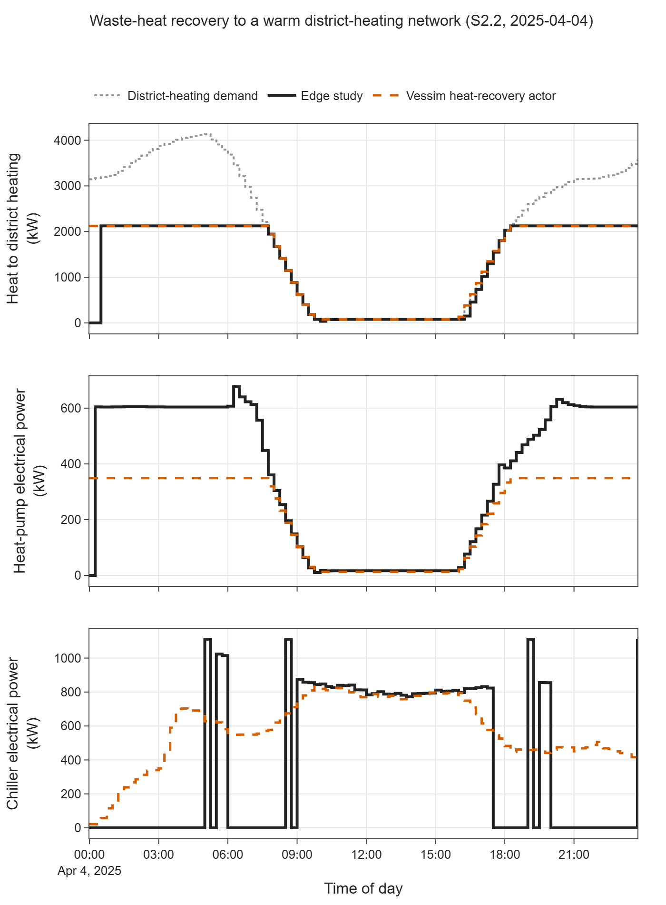

# E04 — Thermal and cooling

- Branch: `exp/e04-thermal-cooling` (branched from `exp/e03-dynamic-workload`, which holds the shared helpers and
  is not yet merged into `main`)
- Notebook: `notebooks/E04_thermal_cooling.ipynb`
- Date: 2026-11-11
- Vessim: 0.16.0 (PyPI), source read at commit `3feef2d`; edge study at commit `3e8533a`
- Wall time: notebook ≈ 24 s end to end; 28 Vessim runs in 0.75 s (6 ms per simulated day at 15 min, 89 ms at
  1 min). One extra edge study run (S2.2) took 161 s and was done once to produce a reference CSV.

## Question

Can cooling, outdoor-temperature dependence, room temperature and waste heat be represented in Vessim, and with
what fidelity loss compared with the edge study?

## Setup

- **Vessim's thermal scope:** the Vessim source has no heat, temperature or cooling term. Actors return one
  electrical power per step plus a free-form state dict, and they cannot read grid signals.
- **Edge study cooling chain (heat mode `none`, S1.2):**
  - `simulators/cooling_crah.py`: CRAH fan, cubic in air flow;
  - `simulators/cooling_chiller.py`: trim chiller with COP = 0.4 × Carnot, clipped to 1.5–4.5, condenser at
    outdoor + 10 K;
  - `simulators/pump_dc.py` and `simulators/pump_chiller_evap.py`: two pumps, linear in water flow.

  No room-air model is connected, so the CRAH works with its constant default return-air temperature (30 °C). The
  chiller holds the chilled water at its 15 °C set point. The chain is therefore an algebraic function of IT heat
  and outdoor temperature, evaluated once per 15-min physical step with the IT power at the start of the step.
- **Edge study heat recovery (heat mode `warm`, S2.2, 2025-04-04):**
  - stratified hot-water tank with a protection controller (34–38 °C);
  - heat pump with a PI-trimmed, loss-compensating demand request, 600 kW compressor;
  - district-heating heat exchanger;
  - heating-network demand that ramps linearly with the outdoor temperature.
- **Inputs:** IT power and outdoor temperature (15 min) from the edge runs:
  - S1.2: `data/e04_edge_s1_2_cooling_15min.csv`, extracted from the E01 run;
  - S2.2: `data/e04_edge_s2_2_heat_15min.csv`, from a new run.

  The day-ahead price is recovered from the LP columns as in E02. No randomness is involved.
- **Variants:**

| Variant | How it is built in Vessim | Custom lines of code |
|---|---|---|
| Constant overhead (0.285 × IT) | built-in `Consumer` with a precomputed trace; this is the planning assumption in the edge `controller.py` and `scheduler.py` | 0 |
| Linear fit to edge run | E03's `CoolingProxy` actor, refitted to the step-start values | 7 |
| Ported edge cooling chain | `CoolingChain` equations + `PowerProbe` (an IT trace that exposes its power) + `ChainCooling` actor | 45 + 8 + 13 |
| Room thermal node | `RoomThermal` actor | 38 |
| Waste-heat recovery | `HeatRecovery` actor + `HeatPumpParams` | 31 |
| Heat revenue | `DeliveredHeat` metric | 10 |
| District-heating demand | ported from `heating_network.py` | 7 |

  Helpers are in `src/vessim_eval/thermal.py`. Line counts exclude comments and docstrings.
- **Room node parameters (assumed; the edge study has no room model):**
  - thermal capacity 240 MJ/K, which is ≈ 1 K/min rise after a full cooling stop at 4 MW;
  - set point 24 °C, limit 27 °C (ASHRAE recommended inlet maximum);
  - proportional control with a 15-min time constant, capped by the CRAH capacity (5 000 kW of heat).
- **Room curtailment event:** 05:00–05:30, the highest day-ahead price of the day. Heat removal is capped at 50 % of
  the IT heat unless the room is at or above 27 °C. An optional precooling window (04:00–05:00, set point 20 °C)
  runs before it. Each case is run at 1, 5 and 15 min, with capacities of 60, 240 and 960 MJ/K at 1 min.
- **Heat-pump calibration (S2.2):**
  - sink 55 °C; source 29.1 °C, the mean of the edge source inlet and outlet while running;
  - this gives COP 6.09, against an edge mean of 6.12;
  - compressor limit 600 kW;
  - heat delivery capped at the edge maximum of 2 123.5 kW, plus one run without that cap.
- **Outdoor-temperature sensitivity:** the S1.2 temperature trace shifted uniformly by +0 to +25 K.

## Results

### Cooling models vs the edge study (S1.2, 15-min step, IT at step start)

| Model | Cooling energy (kWh) | vs edge study (%) | Mean abs. difference (kW) | Peak cooling (kW) | Cooling / IT (%) |
|---|---|---|---|---|---|
| Edge study | 22 926.0 | — | — | 1 301.5 | 25.4 |
| Constant overhead (0.285 × IT) | 25 675.4 | +12.0 | 114.6 | 1 407.6 | 28.5 |
| Linear fit (0.277 · IT − 83.0 kW) | 22 926.0 | 0.0 | 4.4 (max 20.9) | 1 283.1 | 25.4 |
| Ported edge cooling chain | 22 926.0 | 0.0 | < 10⁻¹² | 1 301.5 | 25.4 |

The ported chain matches every component per step to < 10⁻⁶ kW. Daily totals: chiller 20 019.8 kWh, CRAH fan
1 296.9 kWh, data-center pump 1 149.5 kWh, evaporator pump 459.8 kWh.

Feeding the chain with the 15-min *mean* IT power instead of the step-start value gives 23 027.6 kWh (+0.44 %).

### Outdoor-temperature dependence

| Temperature shift | Max outdoor (°C) | Ported chain (kWh) | vs +0 K | Constant overhead (kWh) | Lowest chiller COP |
|---|---|---|---|---|---|
| +0 to +15 K | 13.4–28.4 | 22 926.0 | 0.0 % | 25 675.4 | 4.5 |
| +20 K | 33.4 | 23 955.7 | +4.5 % | 25 675.4 | 3.8 |
| +25 K | 38.4 | 26 422.1 | +15.2 % | 25 675.4 | 3.2 |

- The Carnot-based COP stays above the 4.5 cap until the outdoor temperature reaches ≈ 28.4 °C. The S1.2 day
  (1.7–13.4 °C) lies entirely in the flat part.
- Peak cooling power does not change in any shift: the IT peak falls in the cold early morning.

### Room node: cooling curtailment (240 MJ/K)

| Event, step | Max room (°C) | Saved in window (kWh) | Extra after window (kWh) | Net (kWh) | Largest reduction, 15-min mean (kW) | Largest rebound (kW) | Cost change (€) |
|---|---|---|---|---|---|---|---|
| Curtail, 1 min | 27.5 | 52.6 | 62.2 | +9.7 | 230 | 135 | +0.8 |
| Curtail, 5 min | 29.7 | 65.2 | 75.9 | +10.7 | 382 | 136 | +0.6 |
| Curtail, 15 min | 32.6 | 128.2 | 144.3 | +16.0 | 634 | 230 | +0.3 |
| Precool + curtail, 1 min | 27.6 | 90.4 | 104.0 | +13.7 | 382 | 135 | +0.4 |
| Precool + curtail, 5 min | 29.6 | 128.2 | 144.8 | +16.6 | 382 | 174 | +0.4 |
| Precool + curtail, 15 min | 30.6 | 128.2 | 145.1 | +16.9 | 634 | 184 | +0.2 |

Notes on the curtailment results:

- Without an event, the room node gives exactly the ported chain's power.
- At a 1-min step the curtailment switches on and off around 27 °C, which is visible as spikes in the figure.
- Precooling reached only ≈ 22 °C by 05:00, not 20 °C. At the morning IT peak (≈ 4.9 MW) the CRAH is close to its
  5 MW design heat capacity, so there is little headroom to precool.
- Precooling also adds load at 04:00–05:00, which is the hour of the day's grid import peak.

| Thermal capacity (precool + curtail, 1 min) | Rise rate after full stop (K/min) | Stored cold 20→27 °C as chiller electricity (kWh) | Max room (°C) | Saved in window (kWh) | Net (kWh) | Cost change (€) |
|---|---|---|---|---|---|---|
| 60 MJ/K | 3.8 | 26 | 29.3 | 30.1 | +6.7 | +0.2 |
| 240 MJ/K | 0.9 | 104 | 27.6 | 90.4 | +13.7 | +0.4 |
| 960 MJ/K | 0.2 | 415 | 27.1 | 266.8 | +27.0 | −2.8 |

### Waste-heat recovery (S2.2)

| | Edge study | Vessim heat-recovery actor | Vessim actor, no exchanger limit |
|---|---|---|---|
| Heat-pump electricity (kWh) | 8 758.8 | 5 537.3 (−37 %) | 7 847.5 |
| Heat-pump condenser heat (kWh) | 52 011.9 | 33 702.2 | 47 763.0 |
| Heat delivered to the network (kWh) | 32 423.3 | 33 702.2 (+3.9 %) | 47 763.0 |
| Heat demand met (%) | 65.2 | 67.8 | 96.0 |
| Chiller electricity (kWh) | 8 971.6 | 13 762.2 (+53 %) | 11 151.0 |
| Cooling electricity incl. chiller (kWh) | 10 699.5 | 15 548.2 | 12 916.9 |
| Cooling + heat-pump electricity (kWh) | 19 458.4 | 21 085.5 (+8.4 %) | 20 764.4 |
| Heat revenue at 0.08 €/kWh (€) | 2 593.9 | 2 696.2 | 3 821.0 |

Edge S2.2 heat flows over the day:

| Heat flow | Energy (kWh) |
|---|---|
| IT heat removed by the CRAH | 85 886 |
| Heat-pump evaporator (condenser heat − electricity) | 43 253 |
| Heat-pump condenser | 52 012 |
| District-heating exchanger output | 33 615 |
| Accepted by the network | 32 423 |
| Unmet demand | 17 306 |

The ported heat-demand model matches `heating_network.py` to 1.5 × 10⁻⁴ kW. The `DeliveredHeat` metric equals the
recorder integral.

## Interpretation

1. **Vessim has no thermal layer at all.** Cooling can be represented only as an electrical consumer. Everything
   thermal lives inside user actors:
   - Heat flows between components go through Python references between actors. This works only because Vessim
     samples actors in list order (as in E03).
   - Outdoor temperature cannot be a grid signal for actors, so each temperature-dependent actor holds its own
     trace. Nothing in Vessim checks that two actors read the same weather.
2. **The edge cooling chain without heat recovery is fully representable.** In heat mode `none` the edge chain has
   no thermal state, so a 66-line actor reproduces it exactly. The extra detail of the edge study (CRAH, chiller,
   pumps as separate mosaik simulators) gives no behaviour on this day that a steady-state function does not. The
   COP is capped at 4.5 at all S1.2 temperatures, so cooling depends on IT power alone.
3. **Simple approximations:**
   - A linear fit is good to 4.4 kW on average.
   - The constant 0.285 overhead the edge study uses for planning overestimates its own simulated cooling by 12 %
     (+106 kW at the peak). The cause is that `controller.py` derives it from the `cooling_system.py` model
     (0.95 × 0.3). `scenario.py` no longer uses that model; the scenarios run the detailed chain.
4. **Temperature dependence appears only on hot days** (outdoor > ≈ 28 °C): +15 % cooling energy at a peak outdoor
   temperature of 38 °C. A constant or linear proxy cannot show this; the ported chain does.
5. **Stateful thermal models fit the actor interface.** `sample()` is called once per step and the docstring
   explicitly allows it to advance a model. The room node integrates exactly between samples. The limitation is
   timing: an actor can react to a threshold only at its next sample, and Vessim has no events or zero-crossing
   detection. At the edge study's 15-min physical step, a curtailment overshoots the 27 °C limit by 5.6 K. The same
   would hold for any thermal state in the edge study at that step.
6. **Room-air thermal mass is a weak flexibility.**
   - With realistic capacities the room reaches its limit within minutes.
   - The cooling energy saved is paid back by a rebound that is slightly larger, because fan power is cubic.
   - Even a generous 960 MJ/K stores only ≈ 415 kWh of chiller electricity between 20 and 27 °C and saves 2.8 €.
   - Meaningful thermal flexibility needs a chilled-water or ice store, or the edge study's hot-water tank.
7. **Waste heat has no place in Vessim's balance.** The heat-pump actor reports its heat in the state dict. A
   custom `Metric` (10 lines) can integrate and value it, which makes heat revenue a first-class KPI in the
   experiment record. There is still no heat balance, no heat carrier between microgrids and no thermal storage
   class. Vessim's `Storage` is electrical and the only thing the dispatch policy sees.
8. **The fidelity loss for heat recovery is dominated by the edge model, not by Vessim:**
   - The steady-state actor (no tank) runs the chiller continuously.
   - The edge tank buffers heat and runs the chiller in blocks when its protection limit is hit.
   - The larger difference is a heat-balance gap in the edge chain. The heat pump's condenser produces 52.0 MWh,
     but the district-heating exchanger passes on 33.6 MWh. The exchanger computes the untransferred remainder
     (`Q_finite_W`), but `scenario.py` connects it to nothing, so 18.4 MWh/day (35 % of the condenser heat)
     disappears.
   - The evaporator still extracts 43.3 MWh of waste heat from the tank. This relieves the chiller, so the edge run
     needs 8.4 % less thermal electricity than an energy-conserving model with the same delivered heat.
9. **The exchanger flow limit in S2.2 looks unintended.** The heat pump outputs its condenser-side flow
   (`m_dot_DH_HX_kg_s`), but it is not connected to the exchanger. The exchanger therefore uses its default
   `m_dot_hp_nom_kg_s` = 28 kg/s, giving 0.92 × 28 kg/s × 4.18 kJ/(kg·K) × 20 K ≈ 2.15 MW (2.12 MW after ambient
   losses). That holds although `Q_nom_W` and `Q_cond_nom_W` were raised to 5 MW in the S2.2 configuration.
   - As a result, 35 % of the district-heating demand stays unmet on this day.
   - The heat pump's adaptive compensation reads the cap as exchanger losses and drives the compressor to its
     600 kW limit.
   - Without the cap, the steady-state actor meets 96 % of demand and earns +1 125 € more heat revenue per day.

## Hypotheses

| Hypothesis | Verdict | Evidence |
|---|---|---|
| H2 — No thermal model | **Confirmed** | No thermal term in the Vessim source. Cooling is an electrical consumer, temperatures and heat are actor-internal state, and heat flows are Python references between actors. There is no heat balance, thermal storage or heat dispatch. Electrical-only approximations are possible and, for the edge S1.2 chain, exact (66 lines). Stateful thermal models fit `sample()` but react only at sample instants. Heat can be valued through a custom `Metric`. |
| H4 — Energy-side abstractions are cleaner | **Supported (side result)** | The strict electrical balance has no thermal counterpart in either tool. The edge study's missing heat balance check lets 35 % of condenser heat vanish unnoticed in S2.2. |
| H7 — Fast | **Supported** | 6 ms per simulated day at 15 min, 89 ms at 1 min, including the thermal actors. |

## Implications for the edge data center study

- **Positioning:** the edge study's thermal chain is far beyond anything Vessim offers. It has a stratified tank,
  a heat pump with source and sink temperatures, a district-heating exchanger and network demand, and cold-mode
  free cooling. This is the strongest positioning argument found so far: Vessim has no thermal layer, and adding
  one means writing every component, its coupling order and the heat accounting by hand.
- **Check (S2.2 heat balance):** route `Q_finite_W` somewhere, for example back to the heat pump's condenser
  return or the tank, or limit the heat pump request to what the exchanger can pass on. Then add a per-step heat
  balance assertion: IT heat = heat-pump evaporator + chiller + change in tank energy + losses. This is the thermal
  analogue of Vessim's electrical invariant (E00) and would have caught the 18.4 MWh/day gap. **Effort: low.**
- **Check (S2.2 exchanger flow):** connect the heat pump's `m_dot_DH_HX_kg_s` to the exchanger's
  `m_dot_hp_in_kg_s`, or raise `m_dot_hp_nom_kg_s` with `Q_nom_W`. The 2.12 MW cap leaves 35 % of the heat demand
  unmet and caps heat revenue. **Effort: low.**
- **Fix (planning constant):** replace the 0.285 cooling overhead in `controller.py` and `scheduler.py` with the
  chain's own curve. A linear fit is enough at COP-capped temperatures; otherwise use the chain function with the
  outdoor-temperature forecast. Planning currently overestimates cooling by 12 % (≈ 106 kW at the peak), which
  biases peak-load scheduling. **Effort: low.**
- **Consider (sampling):** the chain uses the IT power at the start of each 15-min step, which undercounts cooling
  energy by 0.44 %. Using the step mean or the IT energy of the step fixes this, as for the grid accounting in E01.
  **Effort: low.**
- **Consider (thermal flexibility):** the edge study has no room-air state (the CRAH return air is a constant
  30 °C). If precooling or cooling curtailment becomes a grid service in the study, room air alone offers little:
  minutes of curtailment, tens to hundreds of kWh, with a rebound. A cold-water store would be the component to
  add. Any such state needs a step finer than 15 min, or analytic sub-stepping, to respect temperature limits.
  **Effort: medium.**
- **Adopt (idea):** a custom-metric style KPI for heat, scoped per component and stored with the experiment
  record (Vessim's `Metric` reads actor states). See E06.
- **Ignore:** nothing thermal from Vessim can be reused, because there is nothing to reuse.

## Limitations of this experiment

- One day per scenario. S1.2 (spring) never leaves the COP-capped region; hot days were only emulated by shifting
  the temperature trace.
- The room node's thermal capacity, set point, limit and controller are assumptions; the edge study gives no
  values. The chain model still assumes a 30 °C CRAH return air when the room temperature changes (no feedback of
  room temperature on fan or chiller).
- The heat-recovery actor is steady state and has no tank, so it is calibrated rather than ported. Its COP source
  temperature and delivery cap are taken from the edge run.
- Cold mode (S2.1, free cooling), the water-cooled mode (S2.3) and the cooling tower were not tested.
- The two S2.2 observations come from reading the edge code and one run. They should be confirmed by the edge study
  authors before they are treated as bugs.
