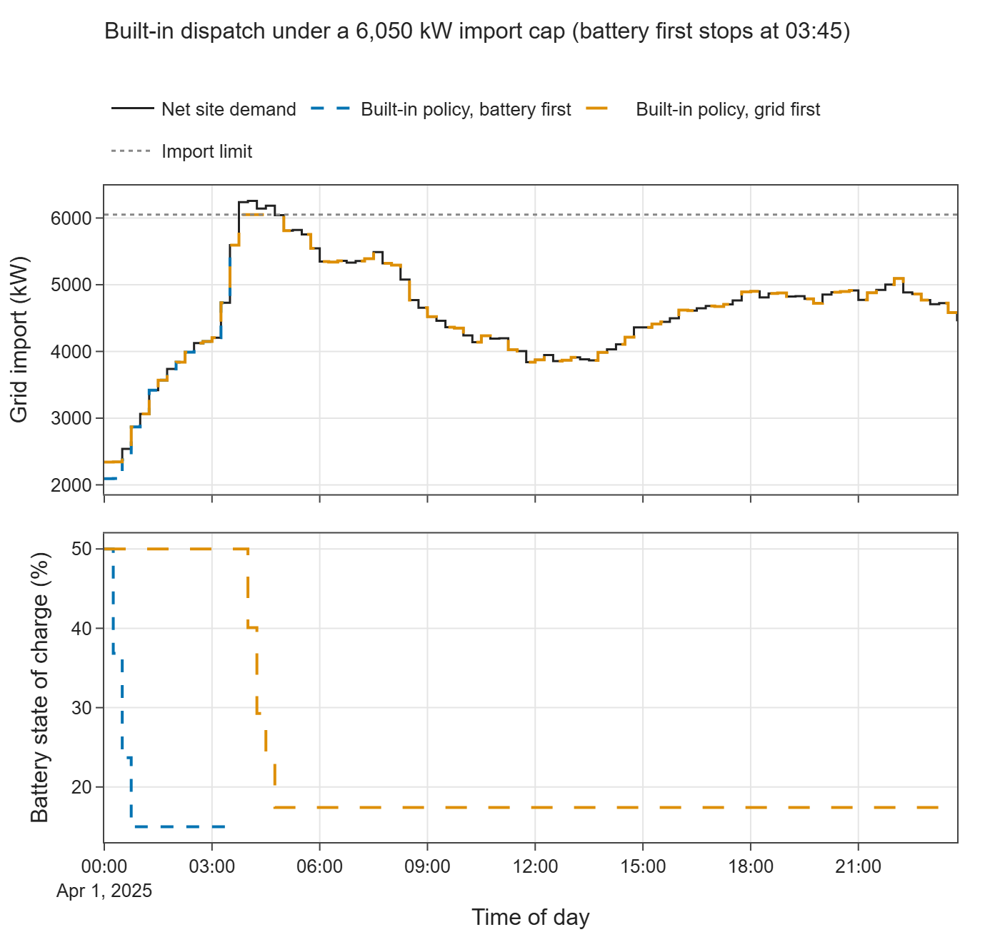
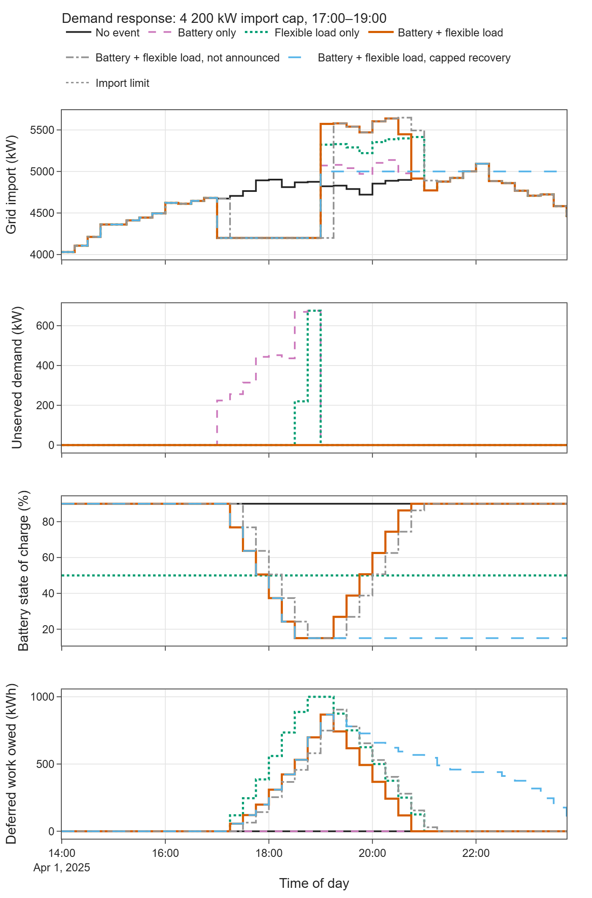
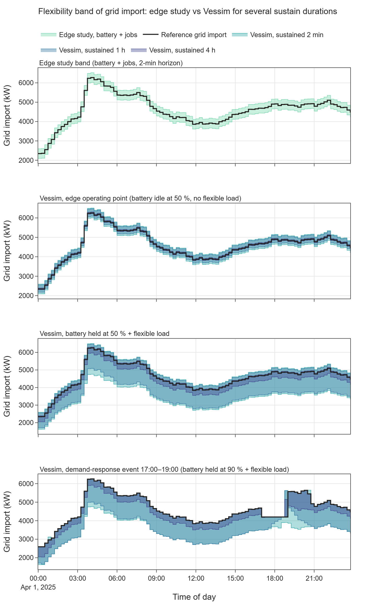
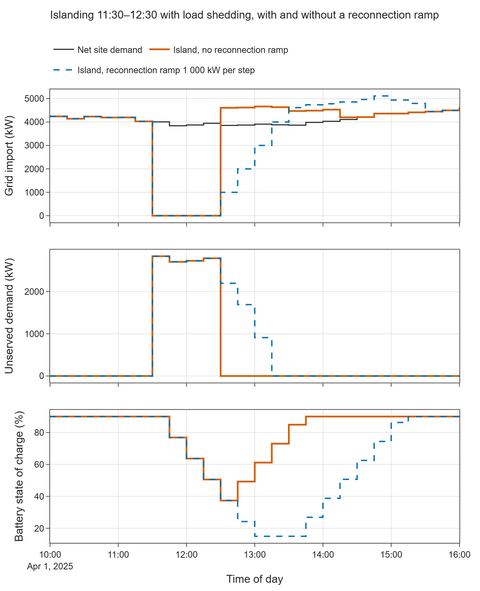

# E05 — Grid-serving flexibility

- Branch: `exp/e05-grid-flexibility` (branched from `exp/e04-thermal-cooling`, which holds the shared helpers and
  is not yet merged into `main`)
- Notebook: `notebooks/E05_grid_flexibility.ipynb`
- Date: 2026-11-13
- Vessim: 0.16.0 (PyPI; identical to the source read at commit `3feef2d`); edge study at commit `3e8533a`
- Wall time: notebook ≈ 24 s end to end; 210 Vessim runs in 3.6 s (median 7 ms per simulated day; max 0.17 s at a
  1-min step). No new edge study run was needed.

## Question

Can Vessim express what the edge study calls grid-serving flexibility? Four parts:

- grid limits (import cap, ramps);
- a demand-response event;
- a flexibility band (minimum / reference / maximum grid power);
- islanding.

## Setup

- **Site:** edge scenario S1.2, 2025-04-01, one day, 15-min IT, cooling, building and PV from
  `data/e01_edge_s1_2_15min.csv`. Net demand is 2.3–6.3 MW (mean 4.6 MW). The largest 15-min increase is 862 kW (at
  03:30–04:00). PV peaks at 594 kW. Price as in E02.
- **Battery:** edge parameters (500 kWh, ±250 kW, SOC 15–90 %, 95 %/95 %, start 50 %), loss-aware `EfficiencyBattery`
  from E01.
- **Flexible load:** the delay-tolerant share of IT + cooling. This is 20 % (the delay-tolerant energy share of the
  edge job trace, E03), mean 942 kW.
  - It is modelled as `DeferrableLoad`, a Vessim `Dispatchable`. It may run below its reference while the deferred
    work owed (backlog) stays ≤ 1 MWh, and up to 500 kW above it while there is backlog.
  - It cannot run ahead of its reference, and the backlog has no deadline.
  - This is an **upper bound** on job flexibility: work is treated as divisible and interruptible at no cost. The edge
    study moves whole non-preemptive jobs; in E03 the same jobs lowered the 15-min peak by at most 385 kW.
- **Policies:**
  - the built-in `DefaultDispatchPolicy` with two dispatch orders (battery first, Vessim's usual order; grid first);
  - a custom `GridServingPolicy`. It keeps the grid inside its feasible range (limit, ramps, connection) using the
    battery and the flexible load. With the remaining headroom it catches up backlog, then recharges the battery to a
    target SOC (90 % unless stated). A grid signal `flex_activation` can force all flexibility on.
- **Unmet demand:** custom runs add `BalanceSlack`, a dispatchable that takes any remaining imbalance and records it
  as unserved (or spilled) power. Without it, Vessim raises `RuntimeError`.
- **Events and limits:**
  - limits and the connection state come from grid signals;
  - `GridEventController` writes them into the `GridConnection` after each dispatch, as in Vessim's
    `examples/demand_response.py`;
  - they are announced one step ahead unless stated.
- **Parts:**

| Part | Setting |
|---|---|
| A. Import cap | 5 950–6 300 kW, built-in policy, both orders; lowest feasible cap by bisection; compared with the minimum-peak LP from E02 |
| A. Ramp limits | symmetric `ramp_up` = `ramp_down`, lowest feasible value by bisection at 15, 5 and 1 min, as the same value per step and as the same physical rate; 200 kW per 15 min with the custom policy and slack |
| B. Demand response | import cap 4 200 kW, 17:00–19:00 (the uncontrolled site exceeds it by up to 702 kW and 1 224 kWh); battery only, flexible load only, both, flexible load used first, not announced, recovery capped at 5 000 kW |
| C. Flexibility band | `FlexibilityBand` controller: per tick, each resource's `feasible_range(D)` minus its setpoint, clipped to the grid's limits, for D = 2 min (the edge band horizon, 4 × 30 s), 15 min, 1 h, 4 h; activation check at 06:00, 12:00, 20:00 for 1 h |
| D. Islanding | `connected = False` 11:30–12:30; with and without a reconnection ramp of 1 000 kW per step |

- **Edge reference band:** `flexibility_results.csv` of the E01 S1.2 run (greedy scheduler, 30-s scheduler step,
  horizon step 0), averaged per 15 min into `data/e05_edge_s1_2_flexibility_15min.csv`.
- **Custom code:** helpers in `src/vessim_eval/flexibility.py`. Line counts exclude comments and docstrings.

| Component | Lines |
|---|---|
| `DeferrableLoad` (flexible load as a dispatchable) | 28 |
| `BalanceSlack` (unserved / spilled power) | 9 |
| `GridServingPolicy` (limit-aware dispatch, recovery, activation) | 77 |
| `GridEventController` (limit and connection from grid signals) | 10 |
| `FlexibilityBand` (band recorder) | 22 |

- No randomness is involved.

## Results

### A. Import cap with the built-in policy

| Import cap (kW) | 6 300 | 6 200 | 6 100 | 6 050 | 6 000 | 5 950 |
|---|---|---|---|---|---|---|
| Battery first | completes | fails at 03:45 | fails at 03:45 | fails at 03:45 | fails at 03:45 | fails at 03:45 |
| Grid first | completes | completes | completes | completes | fails at 04:00 | fails at 03:45 |

| | Grid import (kW) |
|---|---|
| Peak without limit | 6 255.3 |
| Lowest feasible cap, battery first | 6 255.6 |
| Lowest feasible cap, grid first | 6 039.7 |
| Minimum peak, perfect-foresight LP (E02) | 6 005.3 |

A failure is reported as `RuntimeError: Unmet demand of 238568 W: dispatch must balance exactly.` and ends the run.

### A. Ramp limits with the built-in policy

A ramp-limited connection with the default `initial_power = 0` fails at 00:00 (unmet demand of 1.09 MW).

| Policy | Step | Lowest feasible ramp, same value per step (kW per step) | Same physical rate (kW per 15 min) |
|---|---|---|---|
| Battery first | 15 / 5 / 1 min | 863 / 863 / 863 | 863 / 2 587 / 12 935 |
| Grid first | 15 / 5 / 1 min | 631 / 613 / 613 | 631 / 1 837 / 9 185 |

Custom policy with slack and a ramp of 200 kW per 15 min:

| Step | Applied as | Unserved (kWh) | Flexible load deferred (kWh) | Battery discharge (kWh) | Spilled (kWh) |
|---|---|---|---|---|---|
| 15 min | — | 184.4 | 1 000.0 | 423.8 | 2.4 |
| 5 min | same value per step | 0.0 | 93.4 | 162.9 | 14.6 |
| 5 min | same physical rate | 699.0 | 1 028.9 | 224.6 | 12.6 |
| 1 min | same value per step | 0.0 | 15.1 | 30.6 | 3.6 |
| 1 min | same physical rate | 986.2 | 1 004.8 | 242.8 | 0.0 |

"Spilled" energy appears when demand falls faster than the ramp allows import to fall and neither the battery nor the
flexible load can absorb the surplus. The built-in policy raises `Unabsorbed surplus` in that case.

### B. Demand-response event (cap 4 200 kW, 17:00–19:00)

With the built-in policy both orders abort at 17:00: unmet demand of 474 kW (battery first, battery already empty) or
224 kW (grid first). The custom policy without slack aborts at 17:00 with battery only.

| Variant | Unserved (kWh) | Import above cap (kWh) | Battery discharge (kWh) | Flexible load deferred (kWh) | Max import 19:00–21:00 (kW) | Final SOC (%) | Cost change vs no event (€) |
|---|---|---|---|---|---|---|---|
| No event | 0.0 | 0.0 | 0.0 | 0.0 | 4 914.9 | 90.0 | 0.0 |
| Battery only | 867.6 | 0.0 | 356.2 | 0.0 | 5 138.0 | 90.0 | −128.2 |
| Flexible load only | 223.8 | 0.0 | 0.0 | 1 000.0 | 5 414.9 | 50.0 | −90.2 |
| Battery + flexible load | 0.0 | 0.0 | 356.2 | 867.6 | 5 638.0 | 90.0 | −41.9 |
| … flexible load used first | 106.4 | 0.0 | 117.4 | 1 000.0 | 5 578.8 | 90.0 | −56.4 |
| … not announced | 0.0 | 118.5 | 356.2 | 904.6 | 5 648.3 | 90.0 | −42.7 |
| … recovery capped at 5 000 kW | 0.0 | 0.0 | 356.2 | 867.6 | 5 000.0 | 26.9 | −94.0 |

- All backlog is caught up by midnight in every variant.
- Unserved energy is not billed, so variants with unserved energy look cheaper.
- The capped-recovery variant ends with 316 kWh less stored energy.
- Without notice, the cap takes effect one interval late at the start (4 674 kW at 17:00–17:15). It also stays one
  interval longer at the end (19:00–19:15).

### C. Flexibility band

Mean band offsets over the day (kW; downward = reduction of grid import):

| Tool | Case | Sustained for | Downward, mean | Downward, min | Upward, mean | Upward, min |
|---|---|---|---|---|---|---|
| Edge study | job band | 2 min | 0 | 0 | 4 | 0 |
| Edge study | battery band | 2 min | 250 | 250 | 250 | 250 |
| Edge study | offline-optimal battery band | 2 min | 39 | 0 | 250 | 250 |
| Vessim | edge operating point (battery idle at 50 %, no flexible load) | 2 min / 15 min | 250 | 250 | 250 | 250 |
| Vessim | edge operating point | 1 h | 166 | 166 | 211 | 211 |
| Vessim | edge operating point | 4 h | 42 | 42 | 53 | 53 |
| Vessim | battery held at 90 % + flexible load | 2 min / 15 min | 1 201 | 860 | 0–2 | 0 |
| Vessim | battery held at 90 % + flexible load | 1 h / 4 h | 1 173 / 347 | 860 / 339 | 0 | 0 |
| Vessim | battery held at 50 % + flexible load | 2 min / 15 min | 1 192 | 716 | 250 | 250 |
| Vessim | battery held at 50 % + flexible load | 1 h / 4 h | 1 082 / 292 | 632 / 292 | 211 / 53 | 211 / 53 |
| Vessim | demand-response event, battery + flexible load | 2 min / 1 h / 4 h | 1 194 / 1 113 / 359 | 296 / 0 / 0 | 19 / 15 / 10 | 0 |

The edge band's reference at horizon step 1 (30 s ahead) is on average 464 kW below the observed reference at step 0
(range −1 171 to +207 kW).

Activation check, battery held at 50 % + flexible load, all flexibility activated for 1 h:

| Start | Direction | Delivered, mean change of import (kW) | Predicted, 1-h band (kW) | Predicted, 15-min band (kW) |
|---|---|---|---|---|
| 06:00 | down | −1 166.2 | −1 166.2 | −1 315.6 |
| 06:00 | up | 210.5 | 210.5 | 250.0 |
| 12:00 | down | −1 057.7 | −1 056.8 | −1 140.5 |
| 12:00 | up | 210.5 | 210.5 | 250.0 |
| 20:00 | down | −1 140.5 | −1 133.5 | −1 217.3 |
| 20:00 | up | 210.5 | 210.5 | 250.0 |

No activation caused unserved energy. The remaining differences (≤ 7 kW) come from the flexible load's reference
changing within the hour; the band assumes it constant.

### D. Islanding (11:30–12:30)

With the built-in policy both orders abort at 11:30 (unmet demand of 4.0 and 3.8 MW).

| Variant | Demand during island (kWh) | PV (kWh) | Battery discharge (kWh) | Flexible load deferred (kWh) | Unserved during island (kWh) | Demand served (%) | Unserved after reconnection (kWh) | Time to full supply after reconnection (min) | Max import 12:30–14:30 (kW) |
|---|---|---|---|---|---|---|---|---|---|
| No reconnection ramp | 4 506.2 | 590.0 | 250.0 | 898.3 | 2 767.9 | 38.6 | 0.0 | 0 | 4 661.5 |
| Ramp 1 000 kW per step | 4 506.2 | 590.0 | 250.0 | 898.3 | 2 767.9 | 38.6 | 1 201.1 | 45 | 4 856.9 |

## Interpretation

1. **Hard grid constraints are first-class in Vessim and almost absent in the edge study.** `GridConnection` has
   import and export limits, per-step ramps and a `connected` flag, and all of them can change during a run. A
   microgrid without a `GridConnection` is islanded by construction. The edge study has one `max_power` per site
   (10 MW in S1.2, never binding). `simulators/power_grid_connection.py` raises `ValueError` when it is exceeded, and
   the scheduler keeps planned IT load below the headroom (`simulators/scheduler.py`, constraint C4). It has no export
   limit, ramps, time-varying limits or islanding.
2. **What an import cap does depends on the dispatch order.**
   - Battery first, Vessim's usual order and the one in its examples: the greedy policy empties the battery by 00:45
     (E01). The cap is then only a check, and any cap below the day's peak aborts the run.
   - Grid first: the built-in policy turns into peak shaving at the cap without any custom code, 35 kW above the
     perfect-foresight optimum.

   The built-in policy still never recharges the battery (there is no surplus to absorb), and a cap set too low ends
   the run.
3. **Ramp limits are per dispatch step and need care.**
   - They are in W per step, not W/s. The same physical ramp rate must be rescaled whenever the step size changes.
   - They also apply to the first step from `initial_power`, which defaults to 0, so any ramp-limited connection fails
     at 00:00 unless the user sets the initial import.
   - With 15-min input traces forward-filled to finer steps, the binding event is the 862 kW jump at a 15-min
     boundary. The required ramp per step is therefore the same at every step size: the jump itself with the battery
     first, and the jump minus the 250 kW battery with the grid first.
   - The same physical ramp rate is 15× tighter per step at 1 min. With the custom policy it costs 986 kWh of shedding
     instead of 184 kWh.

   Results with ramp limits depend on the step size *and* on how inputs are interpolated.
4. **Unmet demand ends the simulation.** Vessim requires an exact balance and raises at the first infeasible step,
   with no partial KPIs beyond the recorder rows written so far. To quantify the cost of a constraint, a fictitious
   slack resource is needed (9 lines). It is easy to write, but every policy has to know about it. The edge study has
   the same behaviour.
5. **Demand response fits Vessim's controller pattern, but timing is the user's job.**
   - Controllers run after dispatch, so a new limit applies from the next step. It must be announced one step ahead,
     which is exactly what Vessim's `demand_response.py` example does.
   - Without notice, the first event interval exceeds the cap (474 kW, 118 kWh), and the cap lingers for one interval
     after the event.
   - The edge study's time-shifted mosaik connections have the same one-step delay.
6. **The event needs both resources, and greedy allocation is not enough.**
   - The battery is power-limited (250 kW against up to 702 kW over the cap).
   - The flexible load is energy-limited (1 MWh backlog against 1 224 kWh over the cap).
   - Only together do they hold the cap. Their order matters: curtailing the load first fills its backlog before the
     event ends while the battery still holds energy, leaving 106 kWh unserved.
   - Splitting energy-limited resources over an event requires knowing the event's length, i.e. look-ahead. Vessim's
     single-step policy interface has no place for it (as in E02).
7. **Rebound is a real cost.** Catching up 868 kWh of deferred work and recharging the battery after the event lifts
   import by up to 723 kW above the no-event day. That is a new evening peak of 5.6 MW, about as large as the
   reduction the event bought (up to 702 kW). Capping recovery at 5 MW avoids the rebound but leaves the battery at 15 % for the rest of the evening,
   so it is not ready for a second event. Vessim has no notion of recovery or readiness. Both had to be written into the
   policy.
8. **A flexibility band is not part of Vessim, but its resource interface makes one easy and honest.**
   - `feasible_range(duration)` already accounts for power *and* energy limits for any duration, so the band for a
     sustained duration needs 22 lines.
   - Activating the band for 1 h delivered exactly the predicted 1-h band (within 7 kW), with no unserved energy.
   - A 15-min band overstates the 1-h deliverable by 40–150 kW.
   - The band needs object references to the resources: `MicrogridState` exposes setpoints and SOC, but no feasible
     ranges.
9. **The edge band answers a different question.**
   - Its horizon is 4 scheduler steps of 30 s, i.e. 2 minutes. Over 2 minutes the battery is always power-limited, so
     the battery band is ±250 kW all day at SOC 50 %, as in Vessim's 2-min band.
   - Sustained for 1 h the same battery offers −166 / +211 kW, and for 4 h −42 / +53 kW.
   - For grid services that last 15 min to hours (balancing, congestion management, demand response), the edge band
     overstates the battery's contribution by 1.2× to 6×.
   - In S1.2 the edge job band is ≈ 0 (0 kW down, 4 kW up): in greedy mode almost no scheduled job can move within the
     2-min horizon.
   - The band reference for 30 s ahead is anchored on average 464 kW below the observed value. The forecast baseline
     for horizon steps ≥ 1 seems to miss part of the load. This was not traced further.
10. **Islanding is expressible, but this site cannot island.**
    - During a 1-h island at the PV peak, PV, the battery and full curtailment of the flexible load cover 39 % of the
      demand; 2.8 MWh must be shed.
    - With a reconnection ramp, the grid restarts from 0 kW (the disconnected interval is the ramp reference) and needs
      45 min to carry the site again, shedding another 1.2 MWh.
    - Vessim cannot represent an *unannounced* outage within an interval: the flag acts at the next dispatch.

## Hypotheses

| Hypothesis | Verdict | Evidence |
|---|---|---|
| H3 — Flexibility management is weak | **Partially confirmed** | Confirmed for quantification and control: no flexibility band, no forecast interface, no look-ahead, no recovery or readiness logic, and unmet demand is an exception. The greedy single-step allocation leaves 106 kWh unserved where a split allocation leaves none. Nuanced for constraints: import / export limits, ramps, time-varying limits and islanding are built in and enforced exactly. A band built on `feasible_range(duration)` (22 lines) was delivered exactly when activated. Total custom code for this experiment: 146 lines. |
| H4 — Energy-side abstractions are cleaner | **Supported (side result)** | Grid constraints live in the grid resource and are validated every step; the edge study has a single never-binding `max_power`. `feasible_range(duration)` gives power- and energy-limited flexibility for any duration from one method. The rough edges are per-step ramp units and the `initial_power = 0` default. |
| H7 — Fast | **Supported** | 210 runs in 3.6 s; median 7 ms per simulated day. |

## Implications for the edge data center study

- **Adopt (band definition):** compute the battery band for *sustained* durations that match the services offered
  (15 min, 1 h, 4 h), using the same SOC-limited formula the scheduler already uses (`_battery_flex_deltas`) with
  `dt_h` = the service duration instead of the 30-s scheduler step. The current 2-min band reports ±250 kW all day,
  but 1 h at SOC 50 % gives −166 / +211 kW and 4 h gives −42 / +53 kW. **Effort: low.**
- **Adopt (resource interface):** a per-resource `feasible_range(duration)` (battery, deferrable jobs, later thermal
  storage), as in Vessim. The band then becomes a sum over resources and the dispatch can use the same method. It
  also gives an activation test: replay the band edge and check that it is delivered, as in 3.4. **Effort: medium.**
- **Adopt (grid model):** extend `power_grid_connection.py` with an export limit, ramp limits and a time-varying
  import limit (demand-response or congestion signal) as a mosaik input. **Effort: low.** Also replace the
  `ValueError` with an unserved-energy output and a counter, so that scenarios with binding limits run to the end and
  report how much demand a limit costs (Vessim cannot do this either; our slack is a workaround). **Effort: low.**
- **Check (band reference):** the band reference for horizon steps ≥ 1 is on average 464 kW (≈ 10 %) below the
  observed value at step 0 in S1.2. The forecast baseline (committed jobs × 1.285 + base load + building − PV) seems to
  miss part of the load, possibly running jobs or idle power. **Effort: low.**
- **Check (job band):** in S1.2 (greedy mode) the job band is 0 kW downward all day. If job flexibility is a claimed
  service, the band should count jobs that can be deferred beyond the 2-min horizon, or use a horizon that matches
  the service. **Effort: low to medium.**
- **Consider (event handling):** the event results show three things the study would need for demand-response
  scenarios: one-step-ahead notice, rebound limits after the event, and a readiness target SOC. Rebound after
  deferring 0.9 MWh reached +723 kW; any demand-response result should report it. **Effort: medium.**
- **Positioning:** the edge study has a flexibility band (job and battery, MILP-based for jobs) and forecasts; Vessim
  has neither, and its policy interface cannot look ahead. Vessim, in turn, has hard grid constraints, ramps,
  time-varying limits and islanding, which the edge study lacks. A combined argument is fair: the edge study
  *quantifies* flexibility, Vessim *enforces* grid constraints, and neither does both.
- **Ignore:** islanding for the current edge sites. Without on-site generation, PV + 500 kWh battery cover < 40 % of
  the load.

## Limitations of this experiment

- One spring day, one site, 15-min input traces. Finer steps forward-fill the inputs, so ramp results at 5 and 1 min
  reflect step-shaped inputs, not physical load ramps.
- The flexible load is an optimistic abstraction: 20 % of IT + cooling, interruptible, divisible, with a 1 MWh backlog
  limit, a 500 kW catch-up limit and no deadlines. These limits are assumptions. A job-level model (E03) would give
  less flexibility and a different band.
- The custom policy is rule-based and greedy, and its event results depend on the resource order. No look-ahead
  allocation was tried. The minimum-peak LP from E02 is the only optimal reference.
- Unserved energy is not priced (no value of lost load), so cost changes of variants with shedding are not comparable.
- The band clips to import / export limits and connection state but ignores ramp limits, which depend on the path.
  It assumes the flexible load's reference is constant over the duration.
- The edge band was taken from the existing E01 run (greedy scheduler, `peak_load` objective). MILP mode or other
  scenarios with more job flexibility were not run. The 464 kW reference offset was not traced to its cause.
